

**ALGEBRA BERNAYS UNIVERSITY** 
**Professional Undergraduate Study Programme in Applied Computer Engineering – Software Engineering**

FINAL THESIS

# HIGH-DIMENSIONAL AUDIO FEATURE EXTRACTION FOR MUSIC SIMILARITY VISUALISATION

Jakov Kačan

Mentor: Borna Skračić

Zagreb, July 2026.

---

## Abstract {#abstract}

Conventional music library management relies on human-assigned metadata (genre tags, artist names, and release information) that describes music categorically rather than sonically. As personal and professional libraries grow to tens of thousands of tracks, this approach fails curators who must reason about timbral texture, harmonic content, and rhythmic character. This thesis presents SonoMap, a cross-platform desktop application that addresses this limitation through content-based audio analysis. The system extracts a comprehensive set of signal-derived descriptors from each audio file, normalises them into a unified feature vector, and applies a two-stage dimensionality reduction pipeline (PCA and UMAP) to generate an interactive two-dimensional visualisation of the entire library, in which point proximity directly reflects acoustic similarity. An optional neural processing tier, combining a pre-trained audio encoder with a library-adaptive metric learning stage, further refines the embedding beyond what handcrafted descriptors can provide. A complementary recommendation algorithm integrates graph-based proximity with harmonic mixing compatibility to evaluate candidate track transitions based on key relationships and tempo ranges. The resulting system enables music curators to explore their collections through the lens of actual sonic content, with direct applicability in professional DJ performance.

**Key words:** Music Information Retrieval (MIR), audio feature extraction, dimensionality reduction, PCA (Principal Component Analysis), UMAP (Uniform Manifold Approximation and Projection), HDBSCAN clustering, metric learning, music visualisation, harmonic mixing, track recommendation

## Table of Contents {#table-of-contents}

- [Abstract](#abstract)
- [1. Introduction](#sec-1)
- [2. Music information retrieval and data preparation](#sec-2)
  - [2.1. Related work](#sec-2-1)
  - [2.2. Audio descriptors](#sec-2-2)
    - [2.2.1. Audio loading and signal representation](#sec-2-2-1)
    - [2.2.2. Rhythm and percussive descriptors](#sec-2-2-2)
    - [2.2.3. Harmonic and tonal descriptors](#sec-2-2-3)
    - [2.2.4. Spectral and timbral descriptors](#sec-2-2-4)
    - [2.2.5. Time-domain descriptors](#sec-2-2-5)
    - [2.2.6. High-level perceptual descriptors](#sec-2-2-6)
    - [2.2.7. Feature data structure](#sec-2-2-7)
  - [2.3. Feature normalisation](#sec-2-3)
    - [2.3.1. Pre-transforms](#sec-2-3-1)
    - [2.3.2. Library-level fitting and normalisation](#sec-2-3-2)
    - [2.3.3. Per-track L2 normalisation and engine-normalised pass-throughs](#sec-2-3-3)
    - [2.3.4. Vectorisation](#sec-2-3-4)
- [3. Dimensionality reduction and clustering](#sec-3)
  - [3.1. Dimensionality reduction](#sec-3-1)
    - [3.1.1. The curse of dimensionality](#sec-3-1-1)
    - [3.1.2. De-noising and intermediate reduction (PCA)](#sec-3-1-2)
    - [3.1.3. Non-linear 2D projection (UMAP)](#sec-3-1-3)
  - [3.2. Clustering algorithms](#sec-3-2)
    - [3.2.1. HDBSCAN pipeline](#sec-3-2-1)
    - [3.2.2. Hyperparameters and noise label](#sec-3-2-2)
  - [3.3. Neural training](#sec-3-3)
    - [3.3.1. Limits of hand-crafted descriptors](#sec-3-3-1)
    - [3.3.2. Pre-trained audio encoder](#sec-3-3-2)
    - [3.3.3. Library-adaptive metric learning (MetricMLP)](#sec-3-3-3)
    - [3.3.4. Graph-structural metric learning (GraphSAGE)](#sec-3-3-4)
- [4. Harmonic and rhythmic track connectivity](#sec-4)
  - [4.1. Harmonic key compatibility and the principles of harmonic mixing](#sec-4-1)
    - [4.1.1. The Camelot Wheel](#sec-4-1-1)
    - [4.1.2. Compatibility rules implemented](#sec-4-1-2)
    - [4.1.3. BPM compatibility](#sec-4-1-3)
  - [4.2. Track recommendation algorithm](#sec-4-2)
    - [4.2.1. Algorithm modes](#sec-4-2-1)
    - [4.2.2. Architecture](#sec-4-2-2)
    - [4.2.3. Composite score formula](#sec-4-2-3)
    - [4.2.4. Display and interaction](#sec-4-2-4)
- [5. System design and implementation](#sec-5)
  - [5.1. Audio processing pipeline](#sec-5-1)
    - [5.1.1. Concurrency and background processing](#sec-5-1-1)
    - [5.1.2. Persistence](#sec-5-1-2)
    - [5.1.3. File loading, format support, and playback](#sec-5-1-3)
  - [5.2. Visualisation](#sec-5-2)
- [6. Application of software and future considerations](#sec-6)
  - [6.1. Results and validation](#sec-6-1)
    - [6.1.1. Library Statistics](#sec-6-1-1)
    - [6.1.2. Feature normalisation validation](#sec-6-1-2)
    - [6.1.3. Dimensionality reduction quality](#sec-6-1-3)
    - [6.1.4. Clustering performance](#sec-6-1-4)
    - [6.1.5. Recommendation algorithm performance](#sec-6-1-5)
  - [6.2. Use cases](#sec-6-2)
  - [6.3. Future considerations](#sec-6-3)
- [7. Conclusion](#sec-7)
- [List of Abbreviations](#abbreviations)
- [Table of Figures](#figures)
- [List of Tables](#tables)
- [Bibliography](#bibliography)
- [Appendix A – SongRecord.h](#appendix-a)
- [Appendix B – Non-strict recommendation analysis](#appendix-b)
- [Appendix C – Strict recommendation analysis](#appendix-c)

---

## 1. Introduction {#sec-1}

The scale at which music is produced and distributed today has outgrown conventional organisational methods. Streaming platforms catalogue hundreds of millions of tracks, while professional curators manage personal libraries of tens of thousands of files. Traditional approaches, such as hierarchical folder structures, third-party metadata providers, and manual track tagging, rely on human-assigned labels that describe music rather than its sonic content. A track filed under “techno” or “1990s” carries no information about its timbre, harmonic texture, or rhythmic density, which are the very properties that determine whether two tracks belong together in a coherent set.

This work presents SonoMap, a cross-platform desktop software system for audio analysis and music library visualisation, built on the premise that acoustic similarity can be computed directly from the audio signal. SonoMap extracts a broad set of signal-derived descriptors, spanning low-level temporal and spectral properties, tonal and harmonic content, and rhythmic structure, and assembles them into a unified high-dimensional feature vector per track, which is applied deterministically across the entire library to yield a consistent, comparable representation.

Because these vectors occupy a space of several hundred dimensions, direct visualisation is infeasible. Dimensionality reduction is applied in two stages: Principal Component Analysis (PCA) first removes noise and redundant variance, and Uniform Manifold Approximation and Projection (UMAP) then produces a two-dimensional embedding that preserves local neighbourhood structure, so acoustically similar tracks cluster together while distant ones are separated. An optional neural tier supplements the handcrafted descriptors: a pre-trained audio encoder generates deep embeddings, and a metric-learning stage adapts the embedding geometry to the character of a user's library

Finally, a complementary recommendation algorithm combines feature-space proximity with harmonic-mixing principles, namely, key compatibility and tempo proximity, so that suggested transitions are both acoustically coherent and practically mixable.

## 2. Music information retrieval and data preparation {#sec-2}

The core of the system’s implementation lies in the Music Information Retrieval components that extract acoustic fingerprints and transform absolute data into structured vectors. This section reviews related work on the subject, introduces a comprehensive set of audio descriptors, and elaborates on normalisation techniques for different value ranges.

### 2.1. Related work {#sec-2-1}

SonoMap builds on three reference points: the Essentia feature-extraction library and two MIR systems for detecting similarity between audio content.

**Essentia** is an open-source C++ library for audio analysis and music information retrieval, providing spectral, temporal, tonal, and high-level descriptors for large-scale industrial applications [[1]](#ref-1). It serves as SonoMap's source of truth for all feature values across the analysis and clustering pipeline.

**MUSIG** (Multi-task Sampling and Inductive learning on Graphs) is Spotify's graph representation-learning approach for tracking similarity, embedding tracks sampled from a node's local neighbourhood into a navigable graph topology [[2]](#ref-2). MUSIG draws on organisational data (playlist co-occurrence), content features, and musical stylistics; since user and playlist data are out of scope here, SonoMap adopts only the content-and-graph aspect, focusing on raw-signal descriptors and GraphSAGE [[3]](#ref-3) feature training.

**XO** by XLN Audio is a drum-sample browser that visualises every sample in a folder as a scatter plot, grouped by drum type, and is also built on Essentia [[4]](#ref-4). It projects with t-SNE, which emphasises local clusters [[5]](#ref-5); SonoMap instead pairs PCA with UMAP to preserve the global structure needed for full-track comparison across genres. XO additionally inspires SonoMap's interface look and feel [[6]](#ref-6).

### 2.2. Audio descriptors {#sec-2-2}

An audio feature descriptor $$D$$ is a single raw output value from any audio analysis process, $$D \in \mathbb{R}$$ stored as a `float`. Some analyses produce a set of values for different frequency bands or time-dependent frames, so they are stored as a `vector<float>` in ascending order by frequency or time. The collection of all raw descriptors forms a unique acoustic fingerprint.

`AudioAnalysisEngine` is the pipeline’s core module, serving as the deterministic source of truth for all audio feature descriptor values. Most of the engine relies on Essentia’s algorithms (`2.1-beta5`), which are invoked via the `EssentiaFactory` static algorithm factory. The “standard” processing mode loads the entire track into memory before analysis commences. [[1]](#ref-1) The value extraction sequence is divided into several sub-methods categorised by feature characteristics, and the outputs of common operations, such as frame cutting or windowing, are reused as inputs to higher-level methods to optimise processing time.

#### 2.2.1. Audio loading and signal representation {#sec-2-2-1}

Before any analysis can begin, audio must be loaded into memory as a `vector<float>` normalised to $$[-1,1]$$ and resampled to exactly 44,100 Hz, as most downstream Essentia algorithms require this sample rate. Audio analysis yields better results on mono audio [[4]](#ref-4), so Essentia’s `MonoLoader` is used, which internally decodes the file via FFmpeg (`2.8`) and applies an equal-weight centre mix of all source channels. [[1]](#ref-1) A hard cap of 3,600,000 samples (60 min) is applied after loading to guard against unusually long files.

For values related to a track's stereo and imaging qualities, a second pass over the same file is performed using Essentia’s `AudioLoader` to obtain full stereo channel data, represented by the `StereoSample` struct. [[1]](#ref-1) Only the first 120 seconds are retained, trading off minor precision for faster analysis, since stereo panorama and LUFS loudness are the only algorithms that utilise the full stereo channel data.

Track duration is precisely determined from actual audio data, rather than song metadata:

$$\text{duration} = \frac{N_{\text{samples}}}{f_s} \tag{1}$$

where $$N_{\text{samples}}$$ is the total number of sample points of the audio signal data, and $$f_s$$ the original track sample rate.

Algorithms that assume stationarity (such as FFT-based spectral analysis) can only be reliably applied to very short windows where the signal is approximately stable. [[7]](#ref-7) To prepare the 1D sample array for such analyses, common preprocessing is applied to the signal:

`FrameCutter` is the first building block of every time-varying descriptor in the pipeline. [[1]](#ref-1) It partitions the raw signal into a temporally-ordered sequence of fixed-length, overlapping windows. Such a windowed section is also called a frame. [[7]](#ref-7) Frame edge overlap is essential for transients that fall exactly at a frame boundary, which would otherwise be split across two frames, causing neither frame to capture them faithfully. Frame size and overlap are defined by algorithm parameters `frameSize` $$N$$ and `hopSize` $$H$$. Harmonic and other frequency-focused analyses use larger frame sizes, while time-domain computations use smaller ones because of the time-frequency resolution trade-off:

$$\Delta t = \frac{H}{f_s}, \quad \Delta f = \frac{f_s}{N} \tag{2}$$

These are inversely linked: increasing $$N$$ improves frequency resolution but blurs time. [[7]](#ref-7) For key, scale, and chord analyses $$N = 4096, H = 2048$$, while spectral and time-domain use $$N = 2048, H = 1024$$ (both with 50% overlap).

`Windowing` (Hann) addresses a critical problem in audio analysis: spectral leakage. Extracting a finite-length frame from an audio signal creates abrupt signal discontinuities at the frame edges. The window function smooths such edges to eliminate this artefact. [[1]](#ref-1)

Finally, the last pre-processing step for all spectral algorithms is the application of the magnitude `Spectrum` on the windowed frame. It’s responsible for transforming the time-domain frame into a frequency-domain representation by applying a Fast Fourier Transform (FFT) of size $$N$$, computing the magnitude for each bin $$k$$, and truncating the upper $$\frac{N}{2} - 1$$ bins, which are conjugate-symmetric duplicates of the lower half. [[1]](#ref-1) [[7]](#ref-7) The output is the magnitude spectrum `vector<float>` of size $$\frac{N}{2} + 1$$, ranging from DC (0 Hz) through Nyquist ($$\frac{f_s}{2}$$). The key detection pipeline uses a finer $$10.8$$ Hz resolution because pitch analysis requires resolving semitone differences, with adjacent semitones near $$A_4$$ only $$\approx 27$$ Hz apart. The coarser $$21.5$$ Hz resolution in the spectral pipeline is sufficient for timbral descriptors such as MFCCs and spectral centroid, which operate on broad perceptual bands.

#### 2.2.2. Rhythm and percussive descriptors {#sec-2-2-2}

Rhythmic features are among the most notable characteristics for track fingerprinting because they distinguish tracks with identical BPM but different groove character (e.g., rigid 4/4 house vs swung jazz). Such descriptors consist of readable identifiers, including tempo (beats per minute, BPM), meter and time signature, tempo stability, and other numeric values, such as onsets, rhythm transform, and BPM histogram analysis values.

The core rhythmic features of a track are derived from beat grid detection using Essentia’s `RhythmExtractor2013` algorithm, which operates on the full signal. [[1]](#ref-1) Beat grid is a list of timestamps in seconds $$[t_1, t_2, t_3, \ldots]$$ which denote the beginnings of beats in music time tracking. Outputs of the method consist of the global BPM estimate, beat timestamps in seconds, tracking confidence $$[0,1]$$ (used for tempo stability), and the per-IBI[^1] BPM values ($$\frac{60}{\Delta t}$$). BPM histogram is further analysed by computing descriptive statistics of the IBI-derived BPM distribution for sample values in $$[60,210]$$ such as BPM arithmetic mean, standard deviation, centroid (weighted centre of mass of a 1-BPM-bin histogram over $$[60,210]$$), histogram variance, skewness, and kurtosis. [[7]](#ref-7) Furthermore, the rhythmic complexity of the track is defined as a coefficient of variation of IBIs [[8]](#ref-8):

$$\text{rhythmic\_complexity} = \frac{\sigma_{\text{BPM}}}{\overline{\text{BPM}}} \tag{3}$$

where $$\sigma_{BPM}$$ is the BPM standard deviation, and $$\overline{\text{BPM}}$$ the BPM arithmetic mean.

Further beat grid analyses with Essentia’s algorithms include: `BeatLoudness` computes loudness and per-band loudness ratios at each beat position; `Beatogram` filters the beat loudness matrix to retain the most salient accents; `BpmRubato` detects regions where tempo fluctuates more than a tolerance threshold, returns rubato region timestamps and total count; and `Meter` returns the time signature numerator (in beats) whose IBI autocorrelation is highest across all frequency bands. [[1]](#ref-1) The `Meter` algorithm is considered experimental as per Essentia’s documentation because the raw period may represent a multi-bar repetition. To mitigate potential inaccuracies in the results, values $$\leq 7$$ are returned as-is (covering 2/4, 3/4, 4/4, 5/4, 6/8, 7/8). In contrast, values $$> 7$$ are divided by $$4$$, $$3$$, or $$2$$ to recover the fundamental bar length, excluding even multiples of $$4$$, which default to 4/4 to avoid incorrect 2/4 detections. All listed algorithms require at least 8 beats of data to produce results; otherwise, they return default values.

An onset is a sudden, significant change or attack in the audio signal, or descriptively, the moment when a new sound event begins. Onset detection is crucial for understanding rhythmic structure and identifying transient events in music because it captures a track's rhythmic texture independently of tempo. The `OnsetRate` algorithm performs full-signal analysis using a complex-domain onset detection function and returns the number of detected onsets per second. Sequentially, the `OnsetDetection` is called with five parallel detection function methods: `HFC` describes the high-frequency content sensitive to percussive transients; `Complex` captures both magnitude and phase transitions for the complex-domain change; `Flux` detects broad spectral change; `MelFlux` applies perceptual weighting as the Mel-band spectral flux; and finally, `RMS` analyses frame energy flux resulting in amplitude-change detection. [[1]](#ref-1) The listed spectral and time-domain analysis methods are explained further in their respective sections within the audio descriptor categories. All five are reported as their mean over all frames.

`RhythmTransform` produces a 129-bin compact frequency-domain representation of a track's periodic rhythmic structure, revealing which periodicities are strongest in the audio signal. Internally, it applies a 2nd-stage FFT along the time axis of each `MelBands` output (a perceptually-spaced logarithmic frequency band scale that mimics how the human ear perceives pitch). [[1]](#ref-1) [[7]](#ref-7) Each bin stores the peak across all rhythm-domain frames rather than the mean, which collapses oscillatory energy. [[8]](#ref-8)

#### 2.2.3. Harmonic and tonal descriptors {#sec-2-2-3}

Harmonic and tonal descriptors, alongside rhythmic features, are the core differentiators of acoustic features between tracks. Contrary to spectral and timbral pitch-invariant analyses, harmonic descriptors uniquely encode the pitch-domain structure of a track, which carries high perceptual and genre-discriminative weight. The distinction between major and minor (Ionian vs. Aeolian, Dorian, Phrygian, etc.) is one of the most perceptually salient differences between tracks. [[9]](#ref-9)

Harmonic Pitch-Class Profile (HPCP) is a 36-bin pitch-class energy distribution histogram derived from framed and windowed signal samples, called using Essentia’s `HPCP` implementation. [[9]](#ref-9) [[1]](#ref-1) The size of 36 bins is selected as a triple resolution of the chromatic scale (3 bins per semitone), with a squared-cosine weighting for smooth frequency-bin weighting, and a pitch-resolution window of $$\frac{4}{3}$$ semitones. Outputs of the analysis consist of the mean and standard deviation of the 36-bin HPCP profile and the folded 12-bin chroma STFT profile for the semitone resolution. Additionally, chroma STFT is CENS-approximated to compute chroma CENS, a smoothed and transposition-aware harmonic representation that is more robust for similarity matching [[10]](#ref-10):

1. Log-compression:

   $$\hat{c}[k] = \log(1 + 10 \cdot c[k]) \tag{4}$$

   where $$c[k]$$ is the raw chroma bin and $$C = 10$$ is the compression factor constant.

2. L1 normalisation:

   $$\tilde{c}[k] = \frac{\hat{c}[k]}{\sum_{j=0}^{11} \hat{c}[j]} \tag{5}$$

   as the division by sum for all frames.

The Tonnetz (Harmonic Network) is a 6-dimensional tonal space representation of pitch relations which projects chroma vectors onto three coordinate pairs corresponding to the circle of fifths, the circle of minor thirds, and the circle of major thirds. It captures interval harmonic relationships not visible in chroma. Since Essentia doesn’t provide an appropriate algorithm, the 6D centroid is computed following [[11]](#ref-11) via:

$$T_{\cos}^{(r)} = \sum_{k=0}^{11} c_k \cdot \cos\left(k \cdot \frac{2\pi \cdot r}{12}\right) \tag{6}$$

and analogously for the sine component, where $$r \in \{7,3,4\}$$ for the respective interval semitone differences.

`Key` is Essentia’s key and scale detection algorithm applied to the mean HPCP across all frames. [[1]](#ref-1) Thorough experimentation was conducted to select the optimal key detection profile type by comparing SonoMap’s results with commercial track analysis software, and it was found that the `edmm` type yields the most appropriate results for the predominantly electronic music library. Electronic music typically doesn’t conform to standard chord progressions and can feature heavy elements that aren’t in sync with the expected key (such as kick drums tuned to a fifth above the root). Even with the optimal key profile type selected, the key analysis periodically returns the dominant chord (one step on the circle of fifths) or minor/major mismatch, which doesn’t impact the overall quality of acoustic matching or track recommendation because one step in the circle of fifths is still considered tolerable for harmonic mixing purposes. Apart from the profile type, different analysis time periods were considered, but results indicated that track segmentation at $$10\%$$ or $$50\%$$ produces unreliable detections, so full-length signal analysis was selected as the best candidate. `Key` algorithm thus outputs the identified key, scale (major or minor), key in Camelot notation (derived with a helper method), key detection strength/certainty in $$[0,1]$$, and the tuning value in Hz used for tuning offset calculation:

$$\Delta f = f - 440\text{Hz} \tag{7}$$

where $$\Delta f$$ is the tuning offset (in Hz), $$f$$ the track tuning (in Hz), and $$440\text{Hz}$$ the standard tuning of $$A_4$$ in Western music.

To fully capture the harmonic movement of a track in time, the normalised 24-bin (12 major + 12 minor) histogram of chord occurrences is computed using the `ChordsDescriptors` algorithm. [[1]](#ref-1) The histogram also reveals the most frequent chord as the one with the highest frame count and the highest rate of chord changes per second, both of which are persisted in the track model.

Additional scalar measures of harmonic character include: `Inharmonicity` as the deviation of partial frequencies from the ideal harmonic series in $$[0,1]$$, the sensory `Dissonance` computed from spectral peak pairs (using Sethares model [[12]](#ref-12)), `OddToEvenHarmonicEnergyRatio` as the ratio of energy in odd-indexed to even-indexed harmonics, and `Tristimulus` 3-component timbral shape descriptor derived from harmonic partials [[1]](#ref-1) [[13]](#ref-13):

1. T1: energy in the fundamental
2. T2: energy in 2nd, 3rd, and 4th harmonics
3. T3: energy in all remaining harmonics

Finally, the YIN pitch detector `PitchYinFFT` operating on the magnitude spectrum returns the 128-bin MIDI semitone histogram (normalised to $$\sum = 1$$) and the fundamental frequency as the mean $$f_0$$ over voiced frames (in Hz). [[1]](#ref-1)

#### 2.2.4. Spectral and timbral descriptors {#sec-2-2-4}

The spectral and timbral descriptor group is the largest single contributor to the global feature vector, accounting for roughly 120 of the 258 audio analysis dimensions. Unlike harmonic descriptors, which model pitch structure, or rhythmic descriptors, which model temporal organisation, spectral and timbral features describe the texture and colour of sound. Table 2.1 provides an overview before the most significant feature families are explained in depth:

*Table 2.1 List of spectral and timbral descriptors*

| Feature Group | Descriptor(s) | Dimensions | Value |
|---|---|:-:|---|
| Cepstral | **MFCCs (mean)** | 13 | Perceptual timbral envelope |
| Cepstral | **GFCCs (mean)** | 13 | Cochlear-filter timbral model |
| Cepstral | **BFCCs (mean)** | 13 | Psychoacoustic loudness model |
| Filterbank energy | **Mel-band energies** | 26 | Energy distribution across 26 mel-spaced bands |
| Filterbank energy | **Bark-band energies** | 24 | Energy distribution across 24 Bark critical bands |
| Filterbank energy | **ERB-band energies** | 24 | Energy distribution across 24 Equivalent Rectangular Bandwidth bands |
| Sub-band structure | **Spectral contrast** | 7 | Peak-to-valley energy ratio per sub-band |
| Linear prediction | **LPC coefficients** | Up to 10 | Resonant formant structure |
| Scalar spectral | **HPSS ratio** | 1 | Ratio of percussive and harmonic energies |
| Scalar spectral | **Centroid** | 1 | Perceived “brightness” |
| Scalar spectral | **Bandwidth** | 1 | Spectral spread around the centroid |
| Scalar spectral | **Flatness** | 1 | Degree of noise-likeness $$[0,1]$$ |
| Scalar spectral | **Rolloff** | 1 | Frequency below which 85% of spectral energy is concentrated |
| Scalar spectral | **Flux** | 1 | Frame-to-frame spectral change rate |
| Scalar spectral | **HFC** | 1 | Energy-weighted toward high frequencies |
| Scalar spectral | **Complexity** | 1 | Number of prominent spectral peaks |
| Scalar spectral | **Strong Peak** | 1 | Ratio of the strongest peak’s magnitude to the mean spectral level |

Mel-Frequency Cepstral Coefficients (MFCCs) are the most widely used feature in Music Information Retrieval and serve as the primary timbral fingerprint in this system. Essentia’s MFCC algorithm implementation is applied on top of the frame-based spectral pre-processing chain. [[1]](#ref-1) The power spectrum of each frame is projected onto the mel scale (a frequency scale that approximates the non-linear frequency resolution of the human auditory system). The time-averaged mean across all frames of a track yields a 13-dimensional vector that captures the stable timbral character of the recording. [[14]](#ref-14) MFCCs alone can achieve genre classification accuracies competitive with many full-feature systems, which is why they are weighted centrally in the global vector. [[15]](#ref-15)

The gammatone-based (GFCCs) and Bark-based (BFCCs) cepstral coefficients follow the same pipeline as MFCCs, but substitute different auditory filter-bank models: GFCC uses a gammatone filter bank (a linear filter whose impulse response approximates the mechanical tuning of individual hair cells in the cochlea which results in more accurate mid-to-high frequency timbral content description), while BFCC uses the Bark scale (divides the audible spectrum into 24 critical bands which are frequency regions within which two tones are perceived as indistinguishable in frequency if they fall within the same band, which is useful for a more detailed description of bass timbre and sub-bass content). [[16]](#ref-16) [[17]](#ref-17) [[1]](#ref-1)

Complementary to the shape of the energy distribution provided by the aforementioned cepstral coefficients, intermediary raw filterbank Mel-band, Bark-band, and ERB-band energies are also persisted in the model to describe how much energy is present in each perceptual frequency band. [[16]](#ref-16) [[17]](#ref-17)

By including all three cepstral coefficients and filterbank families, the feature vector is populated with three complementary descriptions of the spectral envelope and energy bands, each emphasising different frequency regions and perceptual mechanisms. This redundancy is partially mitigated in the PCA step, which will consolidate correlated variance across the three coefficient families while preserving information unique to each.

Furthermore, `SpectralContrast` is among the most discriminative timbral features for music genre classification, yet it differs structurally from both cepstral and filterbank features. [[15]](#ref-15) [[18]](#ref-18) Rather than measuring total band energy, it measures the peak-to-valley ratio within each of six spectral sub-bands, plus an overall valley measure. The Essentia’s algorithm implementation divides the spectrum into six logarithmically spaced sub-bands. Within each band, it computes the peak (brightest bin) and valley (quietest bin) energies and their log-ratio contrast value. [[1]](#ref-1) High contrast indicates a harmonically rich sound with prominent peaks well above the spectral noise floor, while low contrast indicates a noise-like or percussive sound in which energy is spread uniformly across the band, with few prominent peaks. [[18]](#ref-18)

Linear Predictive Coding (LPC) uses a short finite history of past samples to predict the current sample, and the minimisation of prediction error yields a set of coefficients that describe the resonant shape of the signal’s spectrum. LPC coefficients capture analogous resonance structures (such as the body resonance of an acoustic instrument). The first coefficient is always 1.0 by definition and is discarded because it contributes a constant dimension with zero variance. Coefficients 1 through $$N - 1$$ are retained. [[19]](#ref-19)

Harmonic-Percussive Source Separation (HPSS) ratio provides a single scalar descriptor of the overall harmonic-to-percussive energy balance of a track. The implementation follows the median-filter approach in [[20]](#ref-20), as Essentia provides no high-level HPSS algorithm. The spectrogram is constructed manually using the standard `Windowing` + `Spectrum` chain with non-overlapping frames ($$N = H = 2048$$) to minimise memory on analysis, capped at 60 seconds. For each time-frequency bin, horizontal median filtering across $$k_{L_h} = 9$$ time frames isolates slowly-varying harmonic content, while vertical median filtering across $$k_{L_p}$$ frequency bins isolates impulsive percussive content. A Wiener soft mask is then computed per bin:

$$M_{H_{h,i}} = \frac{H_{h,i}^{p}}{H_{h,i}^{p} + P_{h,i}^{p}}, \quad p = 1 \tag{8}$$

and the final ratio is the power-weighted sum of the harmonic mask against the residual percussive mask:

$$\text{ratio} = \frac{\sum_{h,i} M_{H_{h,i}} \cdot W_{h,i}}{\sum_{h,i} \left(1 - M_{H_{h,i}}\right) \cdot W_{h,i}} \tag{9}$$

where $$H_{h,i}^{p}, P_{h,i}^{p}$$ are the harmonic and percussive medians, and $$W_{h,i}$$ is the power spectrogram element at frequency bin $$h$$, time frame $$i$$.

Values greater than 1 indicate a predominantly harmonic signal, while values below 1 indicate percussive or noise-dominated content. [[20]](#ref-20)

Finally, the eight scalar spectral descriptors are computed as single values per frame and then averaged over the track using respective Essentia algorithm implementations [[1]](#ref-1):

*Table 2.2 Values and interpretation of spectral scalar descriptors*

| Scalar Descriptor | Value | Interpretation |
|---|---|---|
| **Spectral Centroid** | Frequency-weighted mean of the spectrum (perceived “brightness”) | A centroid near $$500\text{Hz}$$ indicates a bass-dominated mix; a centroid near 4kHz indicates a treble-dominant recording |
| **Spectral Bandwidth** | Standard deviation of the spectrum around the centroid | Narrow bandwidth signals spectrally focused sounds (sine waves, tuned resonances); wide bandwidth characterises broadband noise or dense polyphony |
| **Spectral Flatness**[^2] | Ratio of the geometric to arithmetic mean of the spectrum | Values near $$1$$ indicate a flat, noise-like spectrum; values near $$0$$ indicate a strongly peaky (tonal) spectrum |
| **Spectral Rolloff** | Frequency below which 85% of spectral energy falls | Rolling-off spectrum around 8kHz is typical of muffled or heavily compressed material; a rolloff above 16kHz indicates a full-bandwidth, airy recording |
| **High-Frequency Content (HFC)** | Energy-weighted sum of the spectrum with linear frequency weighting, emphasizing high-frequency bins | HFC is particularly sensitive to the crispness of transients where a sharp snare attack produces a momentary HFC spike |
| **Spectral Complexity** | Count of the number of significant peaks in the spectrum above an adaptive threshold | A complex harmonic instrument (harpsichord, electric guitar) will produce a high spectral complexity value; a sine wave or sub-bass kick will produce a low value |
| **Strong Peak** | Ratio of the strongest spectral peak’s magnitude to the mean spectral magnitude | Measure of how dominated the spectrum is by a single harmonic partial. Useful for distinguishing purely sinusoidal tones from noise or dense polyphony |

#### 2.2.5. Time-domain descriptors {#sec-2-2-5}

Time-domain descriptor analysis operates directly on the raw waveform samples without any frequency-domain transformations. Such features characterise the amplitude envelope and dynamic behaviour of the signal over time, capturing the difference between a heavily compressed modern master and a dynamically wide classical recording.

There are several methods for measuring the loudness of an audio signal, performed at the waveform level: `RMS` (Root Mean Square) is a linear measure of signal amplitude, computed as the square root of the mean of the squared amplitudes (expressed in dB). RMS is further analysed using descriptive statistics such as the arithmetic mean, standard deviation, maximum, and the 10th and 90th percentiles. Moreover, `Leq` (Equivalent continuous sound level) measures the overall acoustic energy integration, and `DynamicComplexity` describes the loudness variation over time (dynamic range fluctuation). [[1]](#ref-1) Other loudness models use perceptual weighting and are covered in 2.2.6. High-Level Perceptual Descriptors.

Short-time energy is defined as the mean-squared sample value per pre-windowed frame and computed by:

$$\text{STE} = \frac{\sum s^2}{N} \tag{10}$$

where $$s$$ is the raw sample value and $$N$$ is the total sample count. [[21]](#ref-21)

Zero-crossing rate (ZCR) is the count of times the signal crosses 0 (count of sign change) in a pre-windowed frame:

$$\text{ZCR} = \frac{1}{N-1} \sum_{n=1}^{N-1} \mathbf{1}\left[x[n] \cdot x[n-1] < 0\right] \tag{11}$$

where $$N$$ is the frame length in samples, $$x[n]$$ is the sample amplitude at index $$n$$, and $$\mathbf{1}[\cdot]$$ is the indicator function, equals 1 if the condition holds, 0 otherwise. [[21]](#ref-21)

`LogAttackTime` is the logarithm of the time it takes the signal to rise from the attack start to the attack stop threshold for the first detected onset of the applied full signal. [[1]](#ref-1)

Beyond frame-level statistics, the signal's amplitude envelope encodes its macro-dynamic shape over time. Essentia’s `Envelope` algorithm produces a smoothed, rectified amplitude signal via a peak-follower with an attack time of $$10\ ms$$ and a release time of $$50\ ms$$. [[1]](#ref-1) Two global descriptors are computed directly on the envelope vector: envelope centroid, the temporal centre of mass indicating where energy is concentrated in time, and envelope flatness, the geometric-to-arithmetic mean ratio of the envelope, measuring how uniformly amplitude is distributed over time.

Five further SFX descriptors are extracted from the same envelope using Essentia’s SFX algorithms [[1]](#ref-1):

*Table 2.3 List of SFX descriptors*

| Descriptor | Interpretation |
|---|---|
| `MaxToTotal` | Duration-normalised temporal centroid $$[0,1]$$ |
| `MinToTotal` | Duration-normalised temporal centroid $$[0,1]$$ |
| `DerivativeSFX` | Attack sharpness and decay rate |
| `FlatnessSFX` | Proportion of time near the amplitude maximum |
| `TCToTotal` | Duration-normalised temporal centroid $$[0,1]$$ |

Unlike amplitude dynamics, stereo panorama analysis is a separate branch of the time-domain pipeline that operates on the stereo signal captured by `AudioLoader`. Spatial panning is determined per-frame as:

$$\text{panning} = \frac{E_{\text{right}} - E_{\text{left}}}{E_{\text{right}} + E_{\text{left}}} \in [-1,1] \tag{12}$$

where $$E_{\text{right}}, E_{\text{left}}$$ are the channel energies (sum of squared samples per frame).

A panning value of $$1$$ represents a fully right-panned signal, and $$-1$$ represents a fully left-panned signal. Mean panning and standard deviations across all frames are persisted to the model.

#### 2.2.6. High-level perceptual descriptors {#sec-2-2-6}

High-level perceptual descriptors sit at the top of the abstraction hierarchy, closest to how a human listener experiences music. Unlike the low-level features covered in previous sections, which are grounded in signal mathematics, this group consists of standards-compliant perceptual loudness models that weight the frequency spectrum according to psychoacoustic research and derived scalar classifiers like danceability, brightness, perceptual speed, and acoustic/electric ratio that are either heuristic composites or internal Essentia classifiers returning a value in $$[0,1]$$. Although these descriptors carry less raw discriminative power, they provide human-readable metadata directly interpretable in the context of DJ mixing and curation.

Loudness analysis using perceptual models consists of: `LoudnessEBUR128`, Essentia’s algorithm implementation of the gated human-perceived loudness used as the standard measurement for streaming platforms (expressed in LUFS) [[22]](#ref-22). Requires stereo input from `AudioLoader`. [[1]](#ref-1) `LARM` is a psychoacoustic loudness model with frequency weighting which approximates the equal-loudness contours of the human ear at low-to-moderate sound pressure levels. [[1]](#ref-1) Vickers model (Essentia’s `LoudnessVickers`) was designed specifically to correlate with how listeners perceive the loudness of music, particularly the dynamic compression that characterises modern mastering. It uses a sliding short-term window with specific attack/release time constants tuned to music perception. [[23]](#ref-23) [[1]](#ref-1) At last, `ReplayGain` computes RMS energy after frequency weighting (derived from the 83-phon equal-loudness contour) and returns a gain offset in dB relative to a fixed reference level. [[1]](#ref-1) Each loudness model encodes a slightly different aspect of perceived loudness, shaped by its frequency curve and integration window, thereby giving the downstream normalisation and clustering pipeline complementary perspectives on loudness.

Other high-level derived classifiers or scalars which describe the general track overview are listed in the following table:

*Table 2.4 High-level derived classifiers and scalars*

| Descriptor | Interpretation |
|---|---|
| **Danceability** | Based on Detrended Fluctuation Analysis (DFA) of the signal energy. The raw output is in $$[0,3]$$; divided by 3 and clamped to $$[0,1]$$. [[1]](#ref-1) |
| **Intensity** | A spectral-complexity decision tree returning: $$-1$$ for `RELAXED`, $$0$$ for `MODERATE`, and $$1$$ for `AGGRESSIVE`. [[1]](#ref-1) |
| **Brightness** | Spectral centroid normalized by Nyquist and clamped to $$[0,1]$$: $$\displaystyle \text{brightness} = \frac{\text{spectral\_centroid}}{0.5 \cdot f_s} \qquad (13)$$ |
| **Perceptual Duration** | Scans signal from both ends to find the first and last sample exceeding the threshold of $$-60$$ dBFS. |
| **Perceptual Speed** | Weighted blend of three normalised descriptors clamped to $$[0,1]$$: $$\displaystyle \text{perc\_speed} = 0.50 \cdot \frac{\text{bpm}}{180} + 0.30 \cdot \frac{\text{onset\_rate}}{10} + 0.20 \cdot \frac{\text{flux\_mean}}{3} \qquad (14)$$ |
| **Acoustic/Electric Ratio** | Heuristic $$[0,1]$$ approximating how electronically produced the signal sounds: $$\displaystyle \text{AER} = \sum_{i=1}^{5} w_i \cdot s_i \qquad (15)$$ where: • $$w = [0.25, 0.25, 0.20, 0.15, 0.15]$$ • $$s_1 = 1 - \frac{IH}{IH_{max}}$$ • $$s_2 = 1 - \text{CV}(\text{Flux})$$ • $$s_3 = \frac{HPSS}{3}$$ • $$s_4 = 1 - \frac{\sigma_{BPM}}{10}$$ • $$s_5 = 1 - \frac{\mu_{ZCR}}{0.3}$$ |
| **Mood Flags** | Derived from intensity and scale values without any additional algorithm: `Aggressive` for $$\text{intensity} \geq 1$$, `Relaxed` otherwise, and `Happy` for $$\text{intensity} \geq 0 \wedge \text{scale} = \text{Major}$$, `Sad` otherwise. |
| **Fade Flags** | Detection of energy rises or falls for first and last 3 seconds of the signal: Fade-in: $$\displaystyle \frac{\text{rms}_{\text{window2}}}{\text{rms}_{\text{window1}}} > 1.5 \qquad (16)$$ Fade-out: $$\displaystyle \frac{\text{rms}_{\text{window2}}}{\text{rms}_{\text{window1}}} < \frac{1}{1.5} \qquad (17)$$ |

Finally, the section timestamps for the intro end and outro start are defined arbitrarily as the first and last 16 bars, in accordance with electronic music standards. They are used to determine the region of the respective section analysis for future similarity and recommendation algorithms. Beat number is calculated as:

$$t_i = 16 \cdot \text{meter\_numerator} \tag{18}$$

$$t_o = N - 16 \cdot \text{meter\_numerator} \tag{19}$$

where $$t_i, t_o$$ are intro and outro beat numbers, $$\text{meter\_numerator}$$ is the output of Essentia’s `Meter` detection, and $$N$$ is the total number of beats.

Timestamps for beat numbers are persisted, and section detection is skipped for tracks with fewer than $$2 \cdot 16$$ bars.

#### 2.2.7. Feature data structure {#sec-2-2-7}

All extracted descriptors are persisted to a single song record struct (`SongRecord.h`) that serves as the canonical per-track data model. It is organised into 8 semantic groups totalling 137 fields and 796+ vector dimensions (Table 2.5). The complete field listing is provided in Appendix A.

*Table 2.5 Audio features data structure overview*

| Category | Number of Fields | Total Dimensions |
|---|:-:|:-:|
| **Metadata** | 6 | — |
| **Identity** | 29 | 29 |
| **Rhythm** | 18 | 145+ |
| **Harmonic** | 23 | 299 |
| **Spectral / Timbral** | 30 | 302 |
| **Time-Domain** | 21 | 21 |
| **Section Timestamps** | 2 | — |
| **Embedding Vectors** | 8 | — |
| **TOTAL** | 137 | 796+ |

Not all dimensions are used in downstream processes, but they are persisted nevertheless as intermediary values or useful data for future feature implementations.

### 2.3. Feature normalisation {#sec-2-3}

The raw outputs of the audio analysis engine require multi-method normalisation in order to address the wildly different scales of feature values. For example, LUFS loudness is a value in $$[-60,0]$$, MFCC coefficients have values $$[-100,100]$$, while some features denote probabilities, like HPCP bins or danceability, which fall in $$[0,1]$$ and thus don’t require normalisation. Using the large absolute values as-is in downstream dimensionality reduction would dominate Euclidean distances, without providing useful information. Furthermore, not every feature has the same value distribution, so different strategies must be implemented to address Gaussian, heavy-tailed, or strictly bounded distributions. The output of the normalisation step is the global and region embedding vectors used in later stages of the pipeline.

#### 2.3.1. Pre-transforms {#sec-2-3-1}

Before statistical fitting, a few feature groups are passed through a fixed transform that reshapes their distribution into a more stable, well-behaved range. Three helpers are used. Logarithmic compression (`log1p`) takes heavy-tailed energy measures and compresses their exponential tails, so the bulk of the distribution is no longer dominated by a few extremes. Decibel conversion (`toDb`) maps raw linear amplitude onto a logarithmic decibel scale, which is both perceptually meaningful and statistically better behaved for the loudness-related descriptors. Nyquist normalisation rescales the spectral centroid to a sampling-rate-independent $$[0,1]$$ range by dividing it by the Nyquist frequency (half the sampling rate), removing a scale dependence that would otherwise distort distance comparisons across files. [[21]](#ref-21)

The transforms applied to each affected feature group are listed in Table 2.6:

*Table 2.6 Pre-transformation application per feature group*

| Feature Group | Pre-transform |
|---|---|
| **Inharmonicity** | `log1p` |
| **Dissonance** | `log1p` |
| **HFC** | `log1p` |
| **Spectral Flux** | `log1p` |
| **Spectral Bandwidth** | `log1p` |
| **Band Energies** | `log1p` |
| **Spectral Centroid** | Nyquist Division |
| **RMS** | `toDb` |
| **Short Time Energy** | `toDb`[^3] |
| **LPC** | Discard first coefficient ($$\text{LPC}[0] = 1.0$$) |

#### 2.3.2. Library-level fitting and normalisation {#sec-2-3-2}

The main component responsible for normalisation is the `LibraryScaler` module. The library-level operations include two sequential steps performed before any vector is written: the parameter fitting and the actual normalisation based on statistical parameters.

The fitting process iterates the full library once per feature group to compute `ZScoreParam` or `RobustParam` population statistics used for further Z-score and Robust Scaler normalisations. Given a vector of feature group values, Z-score fitting returns the mean $$\mu$$ and standard deviation $$\sigma$$, while Robust Scaler fitting sorts the vector and extracts median and interquartile range IQR order statistics. Variable-length groups (MFCC, MelBands, LPC) are sized to the maximum dimension observed across all songs in the library. [[24]](#ref-24) Z-score normalisation is used for features with approximately Gaussian distributions, such as BPM statistics, ZCR, and energy, by applying the library-fitted `ZScoreParam {mean, std}` parameters to one track [[24]](#ref-24):

$$z = \frac{x - \mu}{\sigma} \tag{20}$$

On the contrary, Robust Scaler normalisation is used for features with heavy-tailed distributions or outlier-prone descriptors, such as perceptual loudness models, dynamic complexity, MFCC/GFCC/BFCC coefficients, inharmonicity, and dissonance. Loudness values in a real library are heavily influenced by mastering loudness wars, meaning a mean-based scaler would be skewed by the loudest or quietest outliers. [[23]](#ref-23) It applies the IQR-based `RobustParam {median, iqr}` [[24]](#ref-24):

$$x' = \frac{x - \text{median}(x)}{\text{IQR}(x)} \tag{21}$$

Normalisation techniques applied per feature group are listed in Table 2.7:

*Table 2.7 Normalisation techniques applied per feature group*

| Feature Group | Normalisation |
|---|---|
| **Rhythm and Tempo** | Z-score |
| **Spectral Scalars** | Z-score |
| **Time-domain** | Z-score |
| **Loudness** | Robust Scaler |
| **Harmonic Scalars** | Robust Scaler |
| **Cepstral Coefficients** | Robust Scaler per coefficient |
| **Band Energies** | Z-score per band |
| **Spectral Contrast** | Z-score per band |
| **LPC coefficients** | Z-score per coefficient |

Missing coefficients (MFCC, LPC) are padded with $$0.0$$ during vectorisation.

#### 2.3.3. Per-track L2 normalisation and engine-normalised pass-throughs {#sec-2-3-3}

Per-track operations don’t require library-fitted parameters and are therefore applied before library-level normalisation. Feature groups HPCP, chroma (STFT and CENS), Tonnetz, and Rhythm Transform encode shape rather than magnitude. The application of L2 normalisation removes energy bias and retains only the distributional pattern [[24]](#ref-24):

$$\hat{v} = \frac{v}{\lVert v \rVert_2} \tag{22}$$

The remaining features are already passed in $$[0,1]$$ by the audio analysis engine, so no further transformation is needed. These include danceability, brightness, perceptual speed, acoustic/electric ratio, and key strength.

#### 2.3.4. Vectorisation {#sec-2-3-4}

The final step of the normalisation process involves assembling all normalised features into a contiguous `std::vector<float>` of exactly 258 floats, which is written to `song.vectors.global` regardless of library size (Table 2.9). Variable-dimension features use the library’s maximum observed dimension during normalisation fitting, then truncate or pad to the fixed targets. This guarantees a homogeneous input to PCA and UMAP across different library configurations.

To correct for dimensionality imbalance between groups of different sizes, scalar multipliers are applied to each feature group during vector assembly. Because squared Euclidean distance sums the squared component-wise differences, multiplying all $$d$$ dimensions of a group by a scalar weight $$w$$ scales that group’s contribution to total distance by $$w^2$$, independently of how the features were normalised. Concretely, if a group $$G$$ occupies $$d_G$$ dimensions and the target effective dimensionality weight is $$w_G$$, each component $$x_i \in G$$ is replaced by $$w_G \cdot x_i$$ before the vector is written. This allows a 36-dimensional group, such as HPCP, and a 5-dimensional group, such as Tempo, to have comparable perceptual weight in downstream PCA and UMAP analyses without altering the normalisation calculations or refitting the scaler parameters.

For the sampled library, which consisted of predominantly electronic tracks (where tempo is a crucial discriminator of style), the following scalar multipliers were used:

*Table 2.8 Feature group scalar multipliers*

| Normalised Group $$G$$ | Weight $$w$$ |
|---|:-:|
| **Tempo** | 3.0 |
| **Engine pass-throughs** | 1.5 |
| **Harmonic scalars** | 1.2 |
| **Harmonic vectors** | 1.2 |
| **Cepstral** | 1.5 |
| **Bands** | 0.6 |
| **Rhythm transform** | 2.0 |
| **LPC** | 0.5 |

while other groups are multiplied by the default scalar $$w = 1.0$$.

*Table 2.9 Structure of the global embedding vector*

| Offset | Count | Normalised Group | Normalisation Method |
|:-:|:-:|---|---|
| 0 | 5 | **Tempo** | Z-score |
| 5 | 5 | **Engine pass-throughs** | — |
| 10 | 6 | **Loudness** | Robust Scaler |
| 16 | 6 | **Spectral scalars** | Z-score |
| 22 | 5 | **Time-domain** | Z-score |
| 27 | 4 | **Harmonic scalars** | Robust Scaler |
| 31 | 13 | **MFCC** | Robust Scaler |
| 44 | 13 | **GFCC** | Robust Scaler |
| 57 | 13 | **BFCC** | Robust Scaler |
| 70 | 36 | **HPCP** | L2 |
| 106 | 12 | **Chroma STFT** | L2 |
| 118 | 12 | **Chroma CENS** | L2 |
| 130 | 12 | **Bass chroma** | L2 |
| 142 | 6 | **Tonnetz** | L2 |
| 148 | 26 | **Mel bands** | Z-score |
| 174 | 24 | **Bark bands** | Z-score |
| 198 | 24 | **ERB bands** | Z-score |
| 222 | 7 | **Spectral contrast peaks** | Z-score |
| 229 | 7 | **Spectral contrast valleys** | Z-score |
| 236 | 12 | **Rhythm transform** | L2 |
| 248 | 10 | **LPC** | Z-score |
| 258 | — | **Total** | |

The vector is now in an appropriate format for dimensionality reduction.

## 3. Dimensionality reduction and clustering {#sec-3}

The following section details the multi-tiered dimensionality reduction applied to the fitted vectors, the similarity-based grouping of nodes, and the expansion of audio descriptors via neural training tiers.

### 3.1. Dimensionality reduction {#sec-3-1}

The dimensionality reduction pipeline operates on the vectorised normalisation output in two sequential phases implemented by the Principal Component Analysis (PCA) and Uniform Manifold Approximation and Projection (UMAP) algorithms. Existing C++ libraries for dimensionality reduction were considered, but their extendibility and quality of results were inconsistent. Consequently, this system employs custom implementations based on the Eigen (`5.0.1`) C++ linear algebra library [[25]](#ref-25), following the original algorithm designs. Their application, hyperparameter choices, and output transformations are described in detail in the upcoming sections.

#### 3.1.1. The curse of dimensionality {#sec-3-1-1}

In high-dimensional spaces, Euclidean distances between points become nearly uniform, eroding the notion of "nearest neighbour" on which both similarity search and visualisation depend. [[26]](#ref-26) The 258-dimensional feature vectors are therefore reduced in two stages: PCA first collapses them to 20–40 decorrelated dimensions, after which UMAP produces the 2D map, thereby recovering meaningful local structure before projection.

#### 3.1.2. De-noising and intermediate reduction (PCA) {#sec-3-1-2}

Principal Component Analysis (PCA) creates new, uncorrelated features (principal components) ranked by the amount of variance in the data they explain. [[27]](#ref-27) By keeping enough components to capture 95% of the variance, it retains the strongest signals while discarding noise and correlated redundancy from the overlapping filterbank features.

This system implements a custom C++ PCA solution using Eigen in two phases:

##### 3.1.2.1 PCA fitting

Fitting assembles the library’s global embeddings into a matrix, decomposes it via SVD, and selects the minimum number of principal components that preserve 95% of the variance.

Songs with populated `vectors.global` of dimension $$d = 258$$ are stacked as rows into an $$n \times d$$ Eigen matrix $$X$$. [[25]](#ref-25) [[27]](#ref-27)

Column-wise means are computed across all $$n$$ rows [[27]](#ref-27):

$$\mu_j = \frac{1}{n} \sum_{i=0}^{n-1} X_{ij}, \qquad j \in [0, d) \tag{23}$$

The mean vector $$\mu$$ is stored in `params_.means` and subtracted from every query vector at projection time, ensuring training and inference share the same origin [[27]](#ref-27):

$$X_c(i,j) = X(i,j) - \mu_j \tag{24}$$

The centred matrix $$X_c$$ is decomposed using Eigen’s `BDCSVD` with `ComputeThinU | ComputeThinV` [[25]](#ref-25) [[27]](#ref-27):

$$X_c = U \cdot \operatorname{diag}(S) \cdot V^{\top} \tag{25}$$

*Table 3.1 Centred matrix decomposition factors in PCA*

| Factor | Shape | Role |
|:-:|:-:|---|
| $$\boldsymbol{U}$$ | $$n \times r$$ | Left singular vectors (discarded after fitting) |
| $$\boldsymbol{S}$$ | $$r$$ | Singular values in descending order |
| $$\boldsymbol{V}$$ | $$d \times r$$ | Right singular vectors; columns are principal component directions |

where $$r = \min(n, d)$$. Decomposing $$X_c$$ directly avoids forming the $$d \times d$$ covariance matrix $$X_c^{\top} X_c$$, which would square the condition number; the $$n \times d$$ SVD path is numerically more stable when $$n \gg d$$.

Furthermore, the smallest component count $$k$$ is chosen such that the cumulative explained variance reaches the `kVarianceGoal` threshold of 95%, then capped at `kMaxComponents` of 50 [[27]](#ref-27):

$$k = \min\left( \operatorname*{argmin}_{k} \left\{ \frac{\sum_{i=0}^{k-1} S_i^2}{\sum_{i=0}^{r-1} S_i^2} \geq 0.95 \right\},\ 50 \right) \tag{26}$$

The first $$k$$ columns of $$V$$ are stored row-major in `params_.components` as the retained PC directions. An adaptive threshold avoids fixing $$k$$ to a value that would either waste dimensions in a homogeneous library or truncate information in a diverse one. At the same time, `kMaxComponents` bounds downstream memory and compute costs in UMAP.

##### 3.1.2.2 PCA projection

A single $$d$$-dimensional global embedding is projected onto the $$k$$ retained principal components by [[27]](#ref-27):

$$x_{\text{proj}}[i] = \sum_{j=0}^{d-1} \left(x[j] - \mu_j\right) \cdot V_k[i,j], \qquad i \in [0, k) \tag{27}$$

This is the standard PCA projection $$(x - \mu)\, V_k$$, where $$V_k$$ is the $$d \times k$$ submatrix of retained component directions. [[27]](#ref-27) The result is written to `song.vectors.pca` and consumed by the UMAP fitting step.

#### 3.1.3. Non-linear 2D projection (UMAP) {#sec-3-1-3}

Uniform Manifold Approximation and Projection (UMAP) is the final dimensionality-reduction step before the analysis can be visualised. UMAP constructs a fuzzy topological graph in the high-dimensional space, then optimises a low-dimensional layout to match it using SGD to minimise the fuzzy set-based loss function. [[28]](#ref-28)

UMAP is a transductive method because it does not generalise analytically to new points. Adding or removing songs requires re-fitting the entire layout. To achieve UI continuity when running UMAP across application restarts for the same library, a deterministic seed of 42 was arbitrarily selected so that both random initialisation and SGD use the same seed.

##### 3.1.3.1 UMAP fitting

Fitting requires at least 3 songs with populated `vectors.pca` of a consistent dimension $$d$$. The PCA vectors are stacked into an $$n \times d$$ Eigen matrix $$X$$, then the following pipeline runs [[25]](#ref-25):

Exact $$k$$-nearest-neighbour lists are built using the Gram-matrix identity [[28]](#ref-28):

$$D^2[i,j] = \lVert x_i \rVert^2 + \lVert x_j \rVert^2 - 2\left(x_i \cdot x_j\right) \tag{28}$$

The cross-term is evaluated as a single $$XX^T$$ matrix multiply (one BLAS gemm), giving $$O(n^2 d)$$ cost with a small constant. Per point, `std::partial_sort` selects the $$k = \min(\text{kNeighbors}, n-1) = 15$$ smallest distances in $$O(n \log k)$$. [[28]](#ref-28) This brute-force approach outperforms a k-d tree for the typical library sizes (hundreds to low thousands of tracks) and PCA dimensions ($$d \leq 50$$) used here.

A per-point bandwidth $$\sigma_i$$ is found for each point such that the sum of membership weights to its $$k$$ neighbours equals $$\log_2(k)$$ (smooth k-NN distance condition) [[28]](#ref-28):

$$\sum_{j \in \text{kNN}(i)} \exp\left(\frac{-\max\left(0,\ d_{ij} - \rho_i\right)}{\sigma_i}\right) = \log_2(k) \tag{29}$$

where $$\rho_i$$ is the distance to the nearest neighbour (zero-shift so that neighbour always has weight 1). $$\sigma_i$$ is located by 64 iterations of binary search over $$[10^{-8}, 10^{6}]$$. A per-point bandwidth adapts the neighbourhood radius to local density, preventing dense clusters from overwhelming sparser regions in the final layout [[28]](#ref-28).

Directed edge weights are computed from the bandwidth-normalised distances [[28]](#ref-28):

$$w[i \to j] = \exp\left(\frac{-\max\left(0,\ d_{ij} - \rho_i\right)}{\sigma_i}\right) \tag{30}$$

Each undirected pair $$\{i, j\}$$ is symmetrised via the fuzzy-union rule [[28]](#ref-28):

$$w_s(i,j) = w[i \to j] + w[j \to i] - w[i \to j] \cdot w[j \to i] \tag{31}$$

Edges with $$w_s < 10^{-6}$$ are discarded. The result is a flat list of weighted edges $$\{i, j, w_s\}$$ representing the high-dimensional topological structure.

Furthermore, the AB parameter fitting is applied using the low-dimensional similarity function [[28]](#ref-28):

$$\Psi(d) = \frac{1}{1 + a\, d^{2b}} \tag{32}$$

Parameters $$a$$ and $$b$$ are fitted to a piecewise target curve controlled by `kMinDist` and `kSpread`: $$f(d) = 1$$ for $$d < \text{minDist}$$, and $$f(d) = \exp(-(d - \text{minDist})/\text{spread})$$ otherwise. 300 sample distances are drawn over $$[0,\ 3 \cdot \text{spread}]$$, and 300 iterations of diagonal-Newton gradient descent minimise the $$L^2$$ residual. With the defaults (`minDist=0.1`, `spread=1.0`), this converges to $$a \approx 1.93$$, $$b \approx 0.79$$.

The final step of the algorithm is the SGD optimisation, where 2D coordinates are initialised uniformly from $$[-10, 10]$$ with seed $$42$$, then optimised for `kEpochs = 200` epochs. Each positive edge $$e$$ is scheduled to fire at a rate proportional to its weight via $$\text{epsPerSample}[e] = w_{\max}/w_e$$, replicating the UMAP “epochs per sample” scheme. [[28]](#ref-28) The learning rate decays linearly from $$1.0$$ to $$0$$.

At each scheduled firing of edge $$(i, j)$$, an attractive gradient pulls the pair together [[28]](#ref-28):

$$g_c^{+} = -\frac{2ab\, d^{2(b-1)}}{1 + a\, d^{2b}}, \qquad \Delta y_i \mathrel{+}= \alpha \cdot \operatorname{clamp}\left(g_c^{+}\left(y_i - y_j\right), -4, 4\right) \tag{33}$$

followed by `kNegRate = 5` repulsive samples $$k \neq i$$ that push unrelated points apart [[28]](#ref-28):

$$g_c^{-} = \frac{2b}{\left(\epsilon + d^2\right)\left(1 + a\, d^{2b}\right)}, \qquad \Delta y_i \mathrel{+}= \alpha \cdot \operatorname{clamp}\left(g_c^{-}\left(y_i - y_k\right), -4, 4\right) \tag{34}$$

Only $$y_i$$ is updated for repulsive steps; the negative sample is not moved. All gradient components are clamped to $$[-4, 4]$$ to prevent exploding updates from coincident pairs.

The result is stored as `UMAPResult`: a flat, interleaved coordinate buffer $$[x_0, y_0, x_1, y_1, \ldots]$$ alongside the parallel `track_id` array, enabling $$O(1)$$ lookup during application.

##### 3.1.3.2 UMAP application

Application writes the fitted 2D coordinates back into each `SongRecord`. A `track_id → index` hash map is built from `result_.track_ids`; for each song in the input, its index is looked up, and `coords_flat[2i]`, `coords_flat[2i+1]` are copied into `song.vectors.umap`. Songs absent from the fitted result (added after the last fit) are left unchanged. The call is a no-op if the projector is not yet fitted.

Hyperparameters used for UMAP fitting are listed in Table 3.2:

*Table 3.2 UMAP hyperparameters*

| Parameter | Value | Rationale |
|---|:-:|---|
| `k_neighbors` | 15 | Standard default; balances local vs. global structure |
| `min_dist` | 0.1 | Allows visible cluster separation without collapsing all intra-cluster variation |
| `spread` | 1.0 | Default scale |
| `epochs` | 200 | Sufficient convergence for library sizes $$< 10{,}000$$ |
| `neg_rate` | 5 | Negative samples per positive edge |

To achieve more cohesive subsequent UMAP projections, the graph enforces a canonical orientation since UMAP’s objective is rotationally invariant. [[28]](#ref-28) The orientation scheme described below is an original derivation of this work. The $$x$$-axis represents increasing BPM, while the $$y$$-axis represents increasing brightness.

Let the set of 2D UMAP embedding points be:

$$p_i = (x_i, y_i), \quad i = 1, \ldots, N \tag{35}$$

with associated BPM values $$b_i$$ and brightness values $$s_i$$.

The cloud is centred:

$$\bar{p} = \frac{1}{N} \sum_{i=1}^{N} p_i, \qquad \tilde{p} = p_i - \bar{p} \tag{36}$$

Fit a linear model without intercept:

$$b_i = w_x \tilde{x}_i + w_y \tilde{y}_i + \varepsilon_i \tag{37}$$

The normal equations give the gradient vector $$\mathbf{w} = \left(w_x, w_y\right)^T$$ [[25]](#ref-25):

$$\mathbf{w} = (\mathbf{X}^T \mathbf{X})^{-1} \mathbf{X}^T \mathbf{b} \tag{38}$$

where $$\mathbf{X}$$ is the $$N \times 2$$ design matrix with rows $$[\tilde{x}_i,\ \tilde{y}_i]$$ and $$\mathbf{b}$$ is the column vector of $$b_i$$.

The vector $$\mathbf{w}$$ points in the direction of increasing BPM in the 2D plane. To rotate the BPM direction to the $$+x$$ axis, normalise the gradient:

$$\hat{\mathbf{w}} = \frac{\mathbf{w}}{\lVert \mathbf{w} \rVert}, \qquad \hat{\mathbf{w}} = \left(\hat{w}_x,\ \hat{w}_y\right) \tag{39}$$

Define the rotation matrix that maps $$\hat{\mathbf{w}}$$ to the unit vector $$(1,0)^T$$:

$$R = \begin{bmatrix} \hat{w}_x & \hat{w}_y \\ -\hat{w}_y & \hat{w}_x \end{bmatrix} \tag{40}$$

Apply the rotation to the centred points:

$$\mathbf{p}_i{}' = R\, \tilde{\mathbf{p}}_i \tag{41}$$

After rotation, the BPM gradient lies along the new $$x'$$-axis. Finally, fixing the $$y$$-axis sign using brightness consists of computing the Pearson correlation between the rotated $$y'$$-coordinates and brightness:

$$\rho = \operatorname{corr}(y', s) = \frac{\sum_{i=1}^{N} (y_i{}' - \bar{y}')\,(s_i - \bar{s})}{\sqrt{\sum_{i=1}^{N} (y_i{}' - \bar{y}')^2 \sum_{i=1}^{N} (s_i - \bar{s})^2}} \tag{42}$$

Define the sign factor:

$$\sigma = \begin{cases} 1, & \rho \geq 0 \\ -1, & \rho < 0 \end{cases} \tag{43}$$

Apply a reflection along the $$y$$-axis if needed:

$$\mathbf{p}_i^{\text{final}} = \begin{bmatrix} 1 & 0 \\ 0 & \sigma \end{bmatrix} \mathbf{p}_i{}' \tag{44}$$

This ensures that brighter songs have larger $$y$$ (positive correlation).

The final canonical coordinates are:

$$\boxed{\mathbf{q}_i = \begin{bmatrix} 1 & 0 \\ 0 & \sigma \end{bmatrix} R\ (\mathbf{p}_i - \bar{\mathbf{p}})} \tag{45}$$

The transform is rigid, so all inter-point distances are preserved:

$$\lVert \mathbf{q}_i - \mathbf{q}_j \rVert = \lVert \mathbf{p}_i - \mathbf{p}_j \rVert \quad \forall i, j \tag{46}$$

### 3.2. Clustering algorithms {#sec-3-2}

Clustering is a deterministic process of identifying points with similar features to form arbitrary groups with similar feature sets, which don’t necessarily carry a semantic label like genre. This system implements the HDBSCAN clustering algorithm. [[29]](#ref-29)

Clustering is performed either on the vectors in PCA space or the UMAP projection, depending on user preference. PCA preserves true Euclidean distances in the feature domain, thereby grounding groups in actual acoustic similarity, whereas UMAP distorts them to emphasise topology. The results of this decision are visible in the final visualisation, where some groups don’t appear together on the 2D map when PCA clustering is selected. Still, their feature vectors were sufficiently similar to be labelled in the same cluster.

Other clustering approaches were considered, mainly k-means and DBSCAN: k-means requires a predetermined k and assumes convex, equally sized clusters. Since music libraries contain an unknown number of style clusters, each with highly variable size and shape, both assumptions are false. DBSCAN uses a fixed global $$\epsilon$$ radius, which cannot adapt to mixed density. Conclusively, HDBSCAN builds a full density hierarchy and selects the most stable cuts via the Excess-of-Mass (EOM) criterion, which automatically handles mixed densities. [[29]](#ref-29)

#### 3.2.1. HDBSCAN pipeline {#sec-3-2-1}

The algorithm proceeds in four stages, each operating on the PCA-reduced or UMAP-projected feature vectors stored in `song.vectors.pca` or `song.vectors.umap`.

All $$\frac{n(n-1)}{2}$$ pairwise Euclidean distances are computed on the vectors using the standard $$L_2$$ norm, accumulating in double to reduce floating-point rounding error [[29]](#ref-29):

$$d(a, b) = \sqrt{\sum_{i} (a_i - b_i)^2} \tag{47}$$

Only the first $$\min(\lvert a \rvert, \lvert b \rvert)$$ dimensions are summed; in normal operation, all vectors share the same dimension, so no truncation occurs.

For each point $$i$$ the core distance $$\text{core}[i]$$ is the distance to its $$k$$-th nearest neighbour (`k=kMinSamples`), providing a local density estimate [[29]](#ref-29):

$$\text{core}[i] = d\left(i,\ \text{kNN}(i)[k]\right) \tag{48}$$

The $$k$$-th order statistic is found with `std::nth_element` in $$O(n)$$ expected time per point. $$k$$ is capped at $$n - 1$$ to handle libraries smaller than `kMinSamples`.

Pairwise Euclidean distances are lifted into mutual-reachability distances (MRD) before the minimum spanning tree (MST) is built [[29]](#ref-29):

$$\text{MRD}(i, j) = \max\left(\text{core}[i],\ \text{core}[j],\ d(i, j)\right) \tag{49}$$

Inflating distances by the larger of the two core distances pulls isolated, low-density points further from dense groups, making the resulting hierarchy robust to noise. The MST is built with Prim’s algorithm at $$O(n^2)$$, which is appropriate for music libraries up to roughly $$n = 5{,}000$$ songs, where the dense implementation is both simple and cache-friendly. The $$n - 1$$ MST edges are passed to the next stage in the order of insertion. [[29]](#ref-29)

Edges are sorted in ascending order of MRD weight (equivalently, in descending order of $$\lambda = 1/w$$) and merged one by one. A Union-Find structure with path-halving tracks connected components; the condensed cluster tree is built by monitoring split events. When two already-clustered components merge, both child clusters are finalised, and a parent cluster is recorded. When a clustered component absorbs unclustered points, those points are added to the existing cluster at the current $$\lambda$$. [[29]](#ref-29)

Cluster stability is accumulated per point as the $$\lambda$$-interval each point spends inside a given cluster:

$$\text{stability}[c] = \sum_{p \in c} \left(\lambda_{\text{join}}(p) - \lambda_{\text{birth}}(c)\right) \tag{50}$$

After all edges are processed, open clusters (those that never split) accumulate remaining stability down to $$\lambda_{\min}$$. The Excess-of-Mass (EOM) criterion then selects the set of clusters, at any mixture of granularities, that maximises total stability: children are preferred over their parent whenever their combined stability exceeds the parent’s. Finally, each point walks up the tree from its earliest-assigned cluster to the nearest selected ancestor, while points with no selected ancestor are assigned the noise label $$-1$$. [[29]](#ref-29)

#### 3.2.2. Hyperparameters and noise label {#sec-3-2-2}

Two constants govern the algorithm’s behaviour:

*Table 3.3 HDBSCAN hyperparameters*

| Constant | Value | Role |
|---|:-:|---|
| `kMinClusterSize` | $$5$$ | Minimum number of points a group must contain to be retained as a cluster. |
| `kMinSamples` | $$1$$ | The neighbour count $$k$$ used to compute core distances. A value of $$1$$ means each point’s core distance equals its distance to its nearest neighbour, producing the most granular density estimate and the largest number of clusters. Higher values smooth density estimates and suppress more points into noise. |

`kMinSamples = 1` is deliberately low in a music collection context: every song, regardless of how isolated in feature space, should be considered for clustering rather than prematurely silenced as noise. The EOM stability criterion is relied upon to discard genuinely unstable micro-clusters rather than a high `kMinSamples` threshold.

Songs assigned label $$-1$$ are noise: points that could not be stably placed into any cluster under the EOM selection. In practice, this captures tracks that are highly eclectic or stand at density boundaries between two otherwise coherent groups. Noise songs remain fully functional in the library and in the recommendation engine; they receive no cluster boost in the scoring formula.

### 3.3. Neural training {#sec-3-3}

In the graph-based inductive representation of music research [[2]](#ref-2), it was noted that pure acoustic features fail to resolve fine-grained similarities within a genre, and a neural training enhancement was proposed for the deterministic audio analysis pipeline. SonoMap implements a three-tier neural enhancement pipeline that progressively refines the feature space used by UMAP.

#### 3.3.1. Limits of hand-crafted descriptors {#sec-3-3-1}

The 258-dimensional global vector described in the vectorisation step encodes a comprehensive inventory of spectral, rhythmic, harmonic, and cepstral measurements. Each dimension is computed from the raw audio signal using a deterministic algorithm, which guarantees consistency and reproducibility but imposes a fundamental limitation: the feature space is constructed from handcrafted filter designs and statistical summarisation operators that were not optimised for the downstream task of perceptual musical similarity.

Two structural problems arise from this. First, many of the 258 dimensions are dominated by low-level physical properties, such as energy, spectral centroid, and loudness, that correlate poorly with the genre- and texture-level distinctions a DJ relies on. High-energy tracks from different genres occupy similar regions of the spectral scalar group, even though they are perceptually unrelated. Second, the scalar weights applied during vectorisation govern inter-group distance balance but cannot reshape the geometry within a group. PCA then performs a linear projection that preserves maximum global variance; it has no mechanism to pull apart tracks that are acoustically similar yet musically distant, nor to bring together tracks whose similarity lies in a non-linear combination of features across groups.

The consequence is visible in UMAP layouts produced from PCA-projected handcrafted features: broad acoustic groupings cluster correctly (a high-BPM techno section separates from ambient tracks), but fine-grained similarity within a stylistic zone is noisy. Tracks that are harmonically and texturally mixable often do not appear as nearest neighbours because no feature group directly encodes perceptual mixability in a calibrated metric space.

These limitations motivate a three-tier neural enhancement strategy. Each tier is fully self-contained and additive: Tier 1 appends a frozen, pretrained perceptual embedding to the feature vector; Tier 2 trains a compact MLP on the library’s own $$k$$-NN graph to produce a calibrated metric space. Tier 3 trains a graph neural network on the library's musical compatibility structure to produce an inductive embedding that overcomes the transductive limitation of UMAP. [[28]](#ref-28)

#### 3.3.2. Pre-trained audio encoder {#sec-3-3-2}

The first tier appends a 512-dimensional perceptual embedding derived from raw audio to the existing 258-dimensional global vector. No training on user data is required, as the encoder is a frozen pretrained model run in pure inference mode.

The selected model is `discogs-effnet-bs64-1` from the Music Technology Group’s Essentia model zoo, exported as an ONNX[^4] (`1.26.0_1`) model. The model was trained on over 2 million music tracks spanning 400 styles from Discogs using an EfficientNet backbone [[30]](#ref-30), making it one of the most genre-diverse publicly available music encoders with a stable ONNX export. [[31]](#ref-31) [[32]](#ref-32) The embedding is extracted from the penultimate layer, yielding a 512-dimensional projection rather than the final classification head, which transfers better to a similarity task.

The encoder expects a log-power mel spectrogram patch of shape $$[1,1,96,187]$$ corresponding to approximately 3 seconds of audio, resampled to 16 kHz, with 96 mel bands, a 512-sample window, and a 256-sample hop. The audio buffer produced by the existing MonoLoader is downsampled from 44.1 kHz to 16 kHz, and a three-second patch is extracted from the centre of the track, skipping the first and last 20% to avoid intros and outros. [[1]](#ref-1) The patch is instance-normalised to zero mean and unit variance before inference. The 512-dimensional output is L2-normalised to the unit hypersphere, then appended to the song’s global vector with a scalar weight $$w_{\text{neural}} = 1.0$$, yielding a combined input dimension of 770 for downstream tiers:

$$v_{\text{combined}} = \left[v_{\text{global}},\ w_{\text{neural}} \cdot \operatorname{enc}(x_{\text{mel}})\right] \in \mathbb{R}^{770} \tag{51}$$

PCA and UMAP automatically adapt to the increased input dimension. When the ONNX model file is absent, the pipeline falls back to the original 258-dimensional vector unchanged.

#### 3.3.3. Library-adaptive metric learning (MetricMLP) {#sec-3-3-3}

The second tier trains a small multi-layer perceptron on the current library’s own feature vectors using triplet loss. [[33]](#ref-33) The resulting 32-dimensional embedding is calibrated to the similarity structure of the specific user library (its genre distribution, energy zones, and harmonic neighbourhoods), rather than to any external dataset.

The training signal is derived entirely from the $$k$$-nearest-neighbour graph of the (optionally Tier-1-augmented) global vector. For each anchor song, the five nearest neighbours in the global feature space serve as positive pairs and are assigned a musical proximity label. No external data or human annotation is required, as the feature space itself acts as the correctness teacher. A three-layer MLP maps the $$D$$-dimensional input to a 32-dimensional L2-normalised embedding:

$$\mathbb{R}^{D} \xrightarrow{\text{Linear}(D,256) \to \text{ReLU}} \mathbb{R}^{256} \xrightarrow{\text{Linear}(256,128) \to \text{ReLU}} \mathbb{R}^{128} \xrightarrow{\text{Linear}(128,32)} \mathbb{R}^{32} \tag{52}$$

Training uses triplet loss with semi-hard negative mining. [[33]](#ref-33) Given an anchor embedding $$z_a$$, positive embedding $$z_p$$, and negative embedding $$z_n$$, the loss is:

$$\mathcal{L} = \max\left(0,\ \lVert z_a - z_p \rVert^2 - \lVert z_a - z_n \rVert^2 + m\right) \tag{53}$$

with margin $$m = 0.3$$. Semi-hard negatives are drawn from songs outside the anchor’s $$k$$-NN set, where the negative distance falls within the interval $$\left(d_{ap},\ d_{ap} + m\right)$$, selecting negatives that are informative without collapsing the embedding space. When no semi-hard negative is available, the nearest non-neighbour (hard negative) is used as a fallback.

The MLP has approximately 100K parameters and occupies roughly 400 KB of disk space. A library of 1,000 songs converges in under two minutes of CPU time over 100 epochs with the Adam optimiser [[34]](#ref-34) and cosine annealing [[35]](#ref-35) from $$10^{-3}$$ to $$10^{-5}$$. The trained model is exported as an ONNX file and loaded by the same `NeuralEncoder` class used in Tier 1. At inference time, a single forward pass on any song’s global vector produces its 32-dimensional embedding with negligible latency.

The `metric_mlp` vector replaces the PCA output as the primary input to UMAP. The fallback chain `metric_mlp` ≻ `pca` ≻ `global` ensures the pipeline degrades gracefully when Tier 2 has not yet been trained. Retraining is triggered automatically on first library load and offered via a “Recalibrate” action when the library grows by more than 15% since the last training. New songs added individually bypass retraining entirely because a single forward pass through the already-trained model produces their embedding inductively.

#### 3.3.4. Graph-structural metric learning (GraphSAGE) {#sec-3-3-4}

The third tier replaces the transductive UMAP bottleneck with a fully inductive graph neural network encoder. [[3]](#ref-3) Once trained, any song added after training receives a 64-dimensional embedding via a single forward pass through the learned aggregator, with no re-fitting of any global model. This directly resolves the limitation documented in the UMAP section: adding or removing songs currently requires rerunning UMAP across the entire library. [[28]](#ref-28)

##### 3.3.4.1 Compatibility graph

The training graph is constructed from two complementary edge types derived entirely from data that the pipeline already computes. Type A edges encode DJ-domain harmonic and rhythmic compatibility: an edge exists between songs A and B with weight:

$$w_A(A, B) = \max\left(0,\ 1 - \delta_{\text{bpm}}/\varepsilon\right)\ \times\ w_{\text{key}}(\Delta_{\text{Camelot}}) \tag{54}$$

where $$\delta_{\text{bpm}}$$ is the distance of the BPM ratio from the nearest harmonic ratio $$\{0.5, 1.0, 2.0\}$$, $$\varepsilon = 0.06$$ ($$\pm 6\%$$ tolerance), and the key factor maps Camelot distances to weights $$\{0 \mapsto 1.0,\ 1 \mapsto 0.6,\ \geq 2 \mapsto 0\}$$. This is the same formula implemented in the recommendation engine, so no new computation is required. Type B edges connect each song to its $$K_c = 10$$ nearest neighbours in the global feature space with a discounted weight of $$0.5 \cdot \cos\left(v_i, v_j\right)$$, guaranteeing graph connectivity for songs with unusual BPM or key values. Where both edge types connect the same pair, the maximum weight is retained.

##### 3.3.4.2 GraphSAGE architecture

The encoder is a two-layer GraphSAGE with mean aggregation. [[3]](#ref-3) At each layer, a node’s new representation is formed by concatenating its own current representation with the mean of its sampled neighbours’ representations, then projecting through a learned weight matrix:

$$h_v^{(l)} = \operatorname{ReLU}\left(W^{(l)} \cdot \left[h_v^{(l-1)} \ \Vert\ \operatorname{MEAN}_{u \in \mathcal{S}(v)} h_u^{(l-1)}\right] + b^{(l)}\right) \tag{55}$$

where $$\mathcal{S}(v)$$ denotes a fixed-size sampled neighbourhood of $$v$$, $$[\cdot \Vert \cdot]$$ is concatenation, and the final output is L2-normalized. The two weight matrices map from the input dimension $$D$$ to the hidden dimension 256, and then from 512 to the output dimension 64. Total parameter count is approximately 165K, regardless of library size.

The stochastic neighbourhood sampling uses $$S_2 = 10$$ one-hop neighbours and $$S_1 = 25$$ two-hop neighbours at each inference step, so each forward pass touches at most $$1 + 10 + 10 \times 25 = 261$$ nodes. This keeps per-song inference fast and independent of global library size.

##### 3.3.4.3 Training objective

The model is trained by unsupervised link prediction using an InfoNCE contrastive loss. [[36]](#ref-36) For each positive pair $$(u, v)$$ sampled with probability proportional to edge weight, so that strongly compatible song pairs are selected as positives more often, the loss is:

$$\mathcal{L}(u, v) = -\log \frac{\exp(z_u \cdot z_v / \tau)}{\exp(z_u \cdot z_v / \tau) + \sum_{w \neq v} \exp\left(z_u \cdot z_w / \tau\right)} \tag{56}$$

with temperature $$\tau = 0.07$$. In-batch negatives (batch size 256) provide 255 implicit negative pairs per anchor with no explicit negative mining. A full-batch forward pass computes all node embeddings at each gradient step, which is practical for library sizes up to approximately 15,000 songs. The learning rate follows a cosine schedule from $$10^{-3}$$ to $$10^{-5}$$ over 150 epochs.

##### 3.3.4.4 Inductive inference

The primary advantage of GraphSAGE over UMAP is that inference is inductive. [[28]](#ref-28) [[3]](#ref-3) When a new song is added to the library after training, the application inserts it into the compatibility graph by computing its BPM/key and content edges to all existing nodes in $$O(N)$$ time, then runs a single forward pass through the trained aggregator to produce the song’s 64-dimensional sage embedding. No global model is re-fitted. The UMAP layout can optionally be refreshed on demand, but for recommendation purposes, the cosine distance in the sage space is sufficient immediately.

The `sage` vector also extends the UMAP input fallback chain: `sage` ≻ `metric_mlp` ≻ `pca` ≻ `global`. The recommendation engine uses the richest available embedding as its primary distance signal. The full tiered composite scoring formula is described in the track recommendation section.

## 4. Harmonic and rhythmic track connectivity {#sec-4}

To improve the usefulness of the implemented visualisation system, the end-users’ standpoints need to be considered, namely, the harmonious compatibility between two tracks in the song-mixing context. This section presents the underlying theory of harmonic mixing and its application in the track recommendation algorithm for graph traversal.

### 4.1. Harmonic key compatibility and the principles of harmonic mixing {#sec-4-1}

Harmonic mixing is the DJ technique of aligning two tracks so that their transition introduces no audible pitch clash, complementing the temporal alignment provided by beat-matching. [[37]](#ref-37) Commercial DJ software determines compatibility by estimating each track's key and favouring keys that match or sit a perfect fourth or fifth apart on the circle of fifths. [[37]](#ref-37) SonoMap inherits this key-affinity model as a lightweight metadata signal that softly or strictly modulates the proximity-based recommendation output.

#### 4.1.1. The Camelot Wheel {#sec-4-1-1}

The Camelot Wheel (Figure 4.1) is the standard representation of key affinity in DJ practice: a double ring encoding all 24 keys as alphanumeric codes, with minor keys on an inner ring (1A–12A) and major keys on an outer ring (1B–12B), numbered 1–12 clockwise so that each step corresponds to a perfect fifth [[37]](#ref-37) [[38]](#ref-38). Each major key and its relative minor share a number  (C major (8B) and A minor (8A) both occupy position 8), so a transition between them introduces no new tones. The notation reduces harmonic compatibility to simple arithmetic: tracks at distance 0 share a key; one-step neighbours share six of seven diatonic scale degrees and overlap consonantly; and same-numbered opposite-letter pairs ($$A \leftrightarrow B$$) are relative major/minor. Because global key estimation is error-prone and cannot rank candidates that share a key [[37]](#ref-37), SonoMap treats Camelot distance only as a soft constraint that reorders nearby candidates, leaving learned audio similarity in UMAP/MetricMLP/GraphSAGE space as the primary ranking signal.

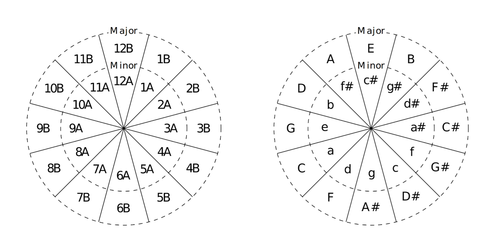{#fig-4-1}

*Figure 4.1 Camelot Wheel and the circle of fifths*

#### 4.1.2. Compatibility rules implemented {#sec-4-1-2}

Each `SongRecord` stores its Camelot token (e.g., `"8A"`), and at recommendation time, a `keyFactor` multiplier is derived from the Camelot distance between the anchor and the candidate and is applied to the composite score (Section 4.2). Distance follows the wheel geometry: for same-mode pairs ($$A \leftrightarrow A$$ or $$B \leftrightarrow B$$) it is the circular distance on the 12-step ring, $$\min(\lvert n_1 - n_2 \rvert,\ 12 - \lvert n_1 - n_2 \rvert)$$; for cross-mode pairs ($$A \leftrightarrow B$$) it is 1 step when the numbers match (a relative major/minor pair) and 2 steps otherwise; missing or invalid tokens incur no penalty (`keyFactor = 1.0`). These distances map to three penalty tiers, consistent with the Camelot Wheel as a guide rather than a hard gate [[37]](#ref-37) [[38]](#ref-38):

These distances map to penalty multipliers as follows:

*Table 4.1 Penalty multipliers for Camelot distances*

| Camelot distance | `keyFactor` | Relationship |
|---|:-:|---|
| **0 steps** | 1.00 | Same key; no penalty |
| **1 step** | 1.15 | Adjacent on wheel, or relative major/minor |
| **≥ 2 steps** | 1.30 | Unrelated keys |

#### 4.1.3. BPM compatibility {#sec-4-1-3}

Tempo compatibility is a prerequisite for any blend-style mix, so a `bpmFactor` multiplier is computed from the candidate-to-anchor ratio $$r = \text{candidateBpm}/\text{anchorBpm}$$ and applied to the same composite score. To accommodate mixing across octave-tempo relationships, $$r$$ is evaluated against three reference ratios: $$1.0$$ (same tempo), $$2.0$$ (double time), and $$0.5$$ (half time) [[39]](#ref-39) [[40]](#ref-40), giving an effective distance:

$$d_{\text{bpm}} = \min(\lvert r - 1.0 \rvert,\ \lvert r - 2.0 \rvert,\ \lvert r - 0.5 \rvert) \tag{57}$$

Within a $$\pm 6\%$$ window ($$d_{\text{bpm}} \leq 0.06$$), no penalty applies; beyond it, a linear penalty raises the factor to a ceiling of $$1.35$$. Together, `keyFactor` and `bpmFactor` act as graduated modifiers on the underlying UMAP distance: they reorder candidates within a neighbourhood, but geometric proximity in the learned embedding remains the dominant ranking criterion unless strict filtering is applied.

### 4.2. Track recommendation algorithm {#sec-4-2}

The track recommendation engine is the output-facing component of SonoMap’s analytical pipeline. Given a user-selected anchor track, it computes a ranked list of candidates from the entire projected library and presents the top results in the recommendations toolbar. The algorithm is intentionally lightweight at inference time: all expensive computations, including audio feature extraction, normalisation, dimensionality reduction, clustering, and neural embedding, are completed during library loading. Recommendation at interaction time involves only in-memory distance lookups and multiplicative factor evaluations, making it effectively instantaneous for library sizes up to tens of thousands of tracks.

#### 4.2.1. Algorithm modes {#sec-4-2-1}

The recommendation engine offers two user-selectable modes that share the same scoring infrastructure. In non-strict mode, harmonic and tempo compatibility act as soft multiplicative penalties: every track is scored and ranked, and a metrically distant candidate is demoted rather than excluded, so UMAP proximity stays the dominant signal. In strict mode, key and tempo are enforced as a hard pre-filter: only candidates within a Camelot distance of $$\Delta \leq 1$$ and within $$\pm 6\%$$ BPM (including half- and double-time) are admitted; the surviving pool is then ranked by the same composite score. Strict mode targets technically tight, immediately beatmixable chains at the cost of variety; if fewer than 15 candidates pass, the toolbar shows only those that do.

#### 4.2.2. Architecture {#sec-4-2-2}

Recommendation proceeds in three stages: candidate construction, scoring, and truncation. The selected track becomes the anchor, and every other projected point is a candidate; no cluster or search pre-filtering is applied, so boundary tracks are not structurally excluded. For each candidate, the engine retrieves the primary embedding distance to the anchor (UMAP squared-Euclidean, or cosine distance in the Tier 2/3 spaces), the HDBSCAN cluster label, and the BPM and Camelot tokens used for $$f_{\text{BPM}}$$ and $$f_{\text{key}}$$. The anchor is excluded from its own candidate set; candidates are sorted in ascending order of score (lower is better, a penalised distance), and the 15 lowest-scoring are passed to the toolbar.

#### 4.2.3. Composite score formula {#sec-4-2-3}

The composite score for a candidate track $$B$$ relative to an anchor track $$A$$ is a product of a primary embedding distance and three multiplicative modifiers:

$$\text{score}(A, B) = d_{\text{primary}}(A, B)\ \times\ f_{\text{cluster}}(A, B)\ \times\ f_{\text{BPM}}(A, B)\ \times\ f_{\text{key}}(A, B) \tag{58}$$

##### 4.2.3.1 Primary distance $$d_{primary}$$

The primary distance uses the richest embedding available in the neural training fallback chain. When the Tier 3 GraphSAGE encoder has been trained, the cosine distance in the 64-dimensional `sage` space is used. When only the Tier 2 MetricMLP is available, cosine distance in the 32-dimensional `metric_mlp` space is used. When neither tier has been trained, the squared Euclidean distance in the 2D UMAP layout serves as the baseline:

$$d_{\text{primary}}(A, B) = \begin{cases} 1 - \dfrac{z_A^{\text{sage}} \cdot z_B^{\text{sage}}}{\lVert z_A^{\text{sage}} \rVert\, \lVert z_B^{\text{sage}} \rVert} & \text{if Tier 3 available} \\[2ex] 1 - \dfrac{z_A^{\text{mlp}} \cdot z_B^{\text{mlp}}}{\lVert z_A^{\text{mlp}} \rVert\, \lVert z_B^{\text{mlp}} \rVert} & \text{if Tier 2 available} \\[2ex] \lVert u_A - u_B \rVert^2 & \text{baseline (UMAP 2D)} \end{cases} \tag{59}$$

This fallback chain ensures that recommendations degrade gracefully when neural training has not yet been run, rather than becoming unavailable. The `sage` embedding is the preferred distance because it was trained to internalise both timbral similarity and DJ-domain compatibility (BPM and Camelot relationships) through the structure of the compatibility graph described in Neural Training. The explicit $$f_{\text{BPM}}$$ and $$f_{\text{key}}$$ multipliers therefore continue to apply across all tiers as a final fine-grained refinement layer that the learned representations alone cannot guarantee to encode precisely.

##### 4.2.3.2 Cluster factor $$f_{cluster}$$

The cluster factor provides a soft boost to candidates that share the anchor’s HDBSCAN cluster:

$$f_{\text{cluster}}(A, B) = \begin{cases} 0.8 & \text{if } \text{cluster}(A) = \text{cluster}(B) \neq -1 \\ 1.0 & \text{otherwise} \end{cases} \tag{60}$$

A value of 0.8 reduces the effective score of within-cluster candidates by 20%, causing them to rank above equal-distance candidates from other clusters. The factor only applies when both tracks have a valid cluster assignment ($$\neq -1$$); HDBSCAN noise-labelled tracks receive no boost. This asymmetry is intentional: noise-labelled tracks are those that the clustering algorithm deemed structurally ambiguous, so artificially boosting them within a cluster could surface outliers that happen to lie near the anchor’s coordinate.

The cluster factor rests on the assumption that HDBSCAN clusters correspond to perceptually coherent musical zones, motivated by using density-based clustering over the UMAP layout rather than distance-partitioning approaches such as $$k$$-means, which would impose convex boundaries on the inherently non-convex structure of real music libraries. [[29]](#ref-29) Tracks within the same cluster are more likely to share the same energy profile, textural register, or stylistic context, making within-cluster recommendations safer bets for a smooth set.

##### 4.2.3.3 BPM factor $$f_{BPM}$$

The BPM factor penalises candidates whose tempo is incompatible with the anchor. The full derivation, including the half/double-time ratio check and the ±6% tolerance window, is presented in 4.1 Harmonic key compatibility and the principles of harmonic mixing. In brief:

$$f_{\text{BPM}}(A, B) = 1.0 + \max\left(0,\ \frac{d_{\text{bpm}} - 0.06}{1 - 0.06}\right) \times 0.35 \tag{61}$$

where $$d_{\text{bpm}} = \min(\lvert r - 1.0 \rvert,\ \lvert r - 2.0 \rvert,\ \lvert r - 0.5 \rvert)$$ and $$r = \text{bpm}_B / \text{bpm}_A$$. The factor is bounded within the range $$[1.0, 1.35]$$.

##### 4.2.3.4 Key factor $$f_{key}$$

The key factor penalises candidates whose harmonic key is incompatible with the anchor, based on Camelot Wheel distance. [[37]](#ref-37) Full derivation is presented in 4.1 Harmonic key compatibility and the principles of harmonic mixing:

$$f_{\text{key}}(A, B) = \begin{cases} 1.00 & \Delta_{\text{Camelot}} = 0 \\ 1.15 & \Delta_{\text{Camelot}} = 1 \\ 1.30 & \Delta_{\text{Camelot}} \geq 2 \end{cases} \tag{62}$$

##### 4.2.3.5 Signal hierarchy

The four terms serve distinct purposes in the score and are deliberately ordered by influence. The primary distance $$d_{\text{primary}}$$ is the only unbounded signal. As the library size grows, the dynamic range of embedding distances dominates the product. The three multipliers are all bounded: $$f_{\text{cluster}} \in \{0.8, 1.0\}$$, $$f_{\text{BPM}} \in [1.0, 1.35]$$, $$f_{\text{key}} \in \{1.00, 1.15, 1.30\}$$. The worst-case combined multiplier is $$1.0 \cdot 1.35 \cdot 1.30 = 1.755$$, meaning metadata penalties can at most scale a candidate’s distance by a factor of roughly $$1.76$$, which is substantial enough to reorder nearby candidates but insufficient to promote a distant track past a genuinely close one. This design preserves the primacy of audio similarity while allowing metadata to break ties in a musically meaningful direction.

#### 4.2.4. Display and interaction {#sec-4-2-4}

The 15 top-ranked candidates become `TrackEntry` objects (track ID, cluster colour, title, artist) rendered in a floating toolbar over the main graph. Each entry's cluster colour indicates whether it remains within the anchor's musical zone or departs from it (noise tracks in neutral grey), mirroring the canvas scheme. Selecting a candidate updates `previewTrackId` and fires `onSongSelected()`, but does not move the anchor, so the list persists until the anchor changes, allowing the DJ to audition several options before committing.

## 5. System design and implementation {#sec-5}

The previously explained theoretical principles are implemented as a standalone C++ desktop application using the JUCE framework. The following sections provide detailed explanations of the audio processing pipeline’s concurrency, data persistence, format support, and output visualisation rendering.

### 5.1. Audio processing pipeline {#sec-5-1}

SonoMap's audio processing pipeline is a sequential, deterministic-then-learned chain that turns raw audio files into 2D coordinates and cluster assignments; Figure 5.1 shows the full schematic.

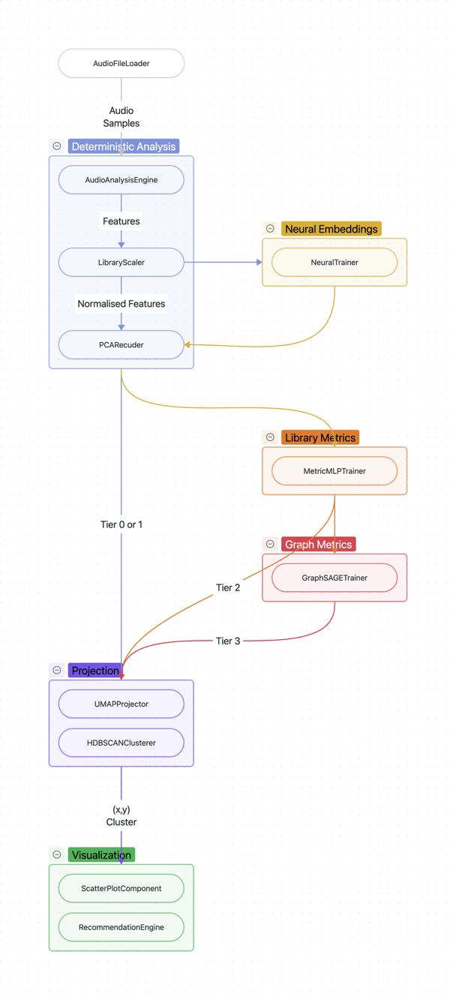{#fig-5-1}

*Figure 5.1 Pipeline architecture schematic*

A recursive file-system scan feeds each file to `AudioFileLoader`, which combines TagLib metadata with Essentia acoustic analysis, producing a populated `SongRecord` with 137 raw fields across 796+ vector dimensions. `LibraryScaler` then fits library-level normalisation statistics in one pass (Z-scores for Gaussian descriptors, IQR-robust for heavy-tailed ones) and applies them in a second pass, yielding the canonical 258-dimensional `vectors.global` per track (Section 2.3).

These global vectors feed the three-tier neural enhancement of Section 3.3: a frozen pretrained encoder (Tier 1) appends a perceptual embedding, a MetricMLP (Tier 2) learns a library-specific 32D metric space, and a GraphSAGE network (Tier 3) produces an inductive 64D embedding from the BPM/key-and-content compatibility graph. Tiers 2–3 are trained out-of-process via a Python subprocess that exchanges `.npy` matrices and serialised weights, which are loaded at runtime via Eigen. The richest available embedding drives the two-stage PCA→UMAP reduction (Section 3.1), selected by a priority fallback chain

$$\texttt{sage} \succ \texttt{metric\_mlp} \succ \texttt{pca} \succ \texttt{global} \tag{63}$$

that degrades gracefully when a tier is unfitted. `HDBSCANClusterer` clusters the projection, and `ScatterPlotComponent` renders the result. Every point queries the same `SongRecord`, so the full acoustic context is always available to the interface.

#### 5.1.1. Concurrency and background processing {#sec-5-1-1}

Acoustic analysis runs on a worker pool sized to one less than the hardware concurrency, with jobs claimed lock-free through an atomic counter. Each worker copies its `SongRecord` under a brief mutex, analyses the local copy without holding locks, and writes back only on success, so aborted jobs never corrupt the store. Essentia constrains this parallelism: standard algorithms are instance-safe once constructed, but FFTW plan creation and the streaming framework's global network singleton are not, so algorithm construction is serialised under a single mutex. In practice, only audio decoding and beat-grid extraction are serialised, while all frame-loop and scalar computation runs concurrently, giving near-linear throughput up to roughly 8–10 workers before the Essentia mutex dominates. Progress is reported per analysis step and propagated to the JUCE message thread, so UI updates never contend with workers.

The deterministic stages (normalisation, PCA, UMAP, HDBSCAN) then run on a thread-pool worker dispatched once the scan completes; UMAP's separate fit/apply lets a neural-tier update re-embed without repeating the SGD phase, and the scatter plot becomes interactive as soon as HDBSCAN finishes, before any neural training. Neural training is a cascading, asynchronous chain of Python subprocesses launched from background threads (each with a timeout) to keep the UI live. A monotonic generation counter captured at launch causes any subprocess whose results arrive after a newer pipeline run to discard its write-back, and a hash of the track IDs lets unchanged libraries skip Tier 2 retraining and load cached weights directly.

#### 5.1.2. Persistence {#sec-5-1-2}

All application state is persisted as plain UTF-8 JSON in the platform data directory, with no database: each save is a full atomic overwrite (`replaceWithText`), so an interrupted write leaves the previous file intact. `AppDataStore` exposes a uniform `save*`/`load*` API that returns `false` on a missing or unparseable file; in that case, the target keeps its default-constructed state. Five files are maintained (Table 5.1): UI and algorithm settings; the full per-track `SongRecord` set with all embeddings; watched folder paths; saved DJ sets; and ignored paths. Forward compatibility is handled defensively: optional embedding fields (`neural`, `metric_mlp`, `sage`) are omitted when empty, and every field added after release is read through a `hasProperty` guard with a struct default, so older files, including those predating a neural tier, load cleanly.

*Table 5.1 Data persistence files and types*

| File | Type | Contents |
|---|---|---|
| `settings.json` | `SettingsModel` | UI preferences and algorithm parameters |
| `songs.json` | `[]SongRecord` | Full acoustic analysis and embedding vectors |
| `folders.json` | `[]ImportedFolderRecord` | Watched directory paths |
| `sets.json` | `[]SetRecord` | Saved DJ sets and transitions[^5] |
| `ignored.json` | `[]string` | Paths excluded from future scans |

#### 5.1.3. File loading, format support, and playback {#sec-5-1-3}

Audio files enter through `AudioFileLoader`, the single entry point for format negotiation and analysis. Ten extensions are accepted (`mp3`, `flac`, `wav`, `aiff`, `aif`, `ogg`, `opus`, `m4a`, `aac`, `wma`); recognition is extension-based, and unlisted files are skipped during recursive folder traversal. The loader keys a hash map on absolute path to separate new files from analysed ones in one pass: new files receive a stub `SongRecord` (a 64-bit path hash as `track_id`, the filename as fallback title) and are queued, while existing records are re-analysed only on a force-rescan or when their beat array is empty. Metadata and cover art are extracted first using TagLib; any TagLib failure is non-fatal, leaving stub defaults in place. Playback is handled by an independent `AudioPlayer` that owns the JUCE audio engine and loads asynchronously on a dedicated thread, so file I/O never blocks the audio callback.

### 5.2. Visualisation {#sec-5-2}

The visualisation layer bridges the dimensionality reduction pipeline and the user. `ScatterPlotComponent` is a JUCE `Component` that renders the 2D UMAP coordinates stored in each `SongRecord` as an interactive scatter plot. It overlays UI toolbars for zoom, pan, and cluster filtering, and optionally shows a recommendations bar anchored to the selected track. The component receives a `ProjectionRun` (the output of a completed UMAP fit), a list of `SongRecord` objects with metadata and cluster assignments, imported folder tags, a live search query, and an active DJ set track list. It fires `onSongSelected` whenever the user clicks a point, connecting the map to the inspector, playback engine, and recommendation system.

The visualisation layer maps each track's 2D UMAP coordinates to screen space through an affine camera transform with a zoom factor and pan offset, allowing user-controlled view driven by drag-to-pan and cursor-anchored scroll-wheel zoom. Rendering proceeds in four ordered passes drawn back-to-front: connection lines between consecutive tracks in the active DJ set; filtered-out points dimmed to 10% alpha; active points as filled circles of radius 3 px in their HDBSCAN cluster colour; and the selected track emphasised with a 30 px halo and a 7 px coloured marker, with an optional preview line to a recommended track. Off-screen points are culled against the visible bounds, and a fixed 12-colour palette assigns each cluster a stable colour across sessions, with HDBSCAN noise points (cluster $$-1$$) rendered in a muted tone.

Interaction layers filtering and selection over this view. A point is "active" (fully rendered and clickable) only when it satisfies both the search filter (a cached text/tag query that is skipped entirely when inactive) and the cluster filter driven by the toolbar chips, which is rebuilt and cleared whenever a new projection loads. Selection resolves on mouse-up to the nearest point within roughly 11 px of screen space, so the hit area tracks the rendered dot size at any zoom. Selecting a track makes it the recommendation anchor, recomputes recommendations, and frames the anchor with its 15 nearest UMAP neighbours inside a padded bounding box; `onSongSelected` then drives the inspector, playback preview, and recommendation display.

## 6. Application of software and future considerations {#sec-6}

### 6.1. Results and validation {#sec-6-1}

The pipeline underwent extensive validation, which ran all incorporated components on a 529-track library consisting primarily of electronic music tracks like house and techno, along with other styles such as rock, ambient, funk, jazz, and shoegaze.

The final output after all analysis steps and neural training for this library can be seen in Figure 6.1:

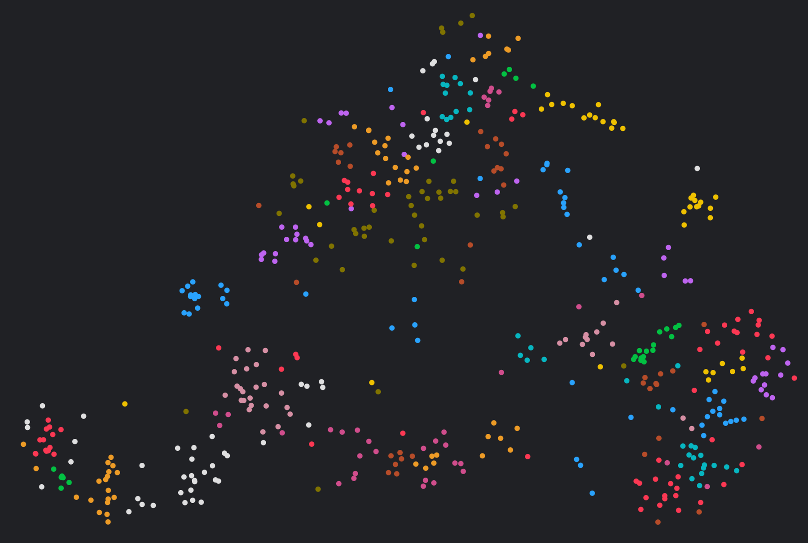{#fig-6-1}

*Figure 6.1 Scatter plot visualisation*

Figure 6.2 is labelled with manual genre and style groups interpreted from most of the grouped tracks. Unmarked areas contain tracks not groupable together, or ones belonging to nearby clusters:

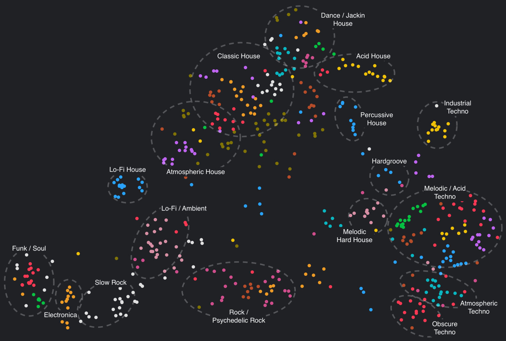{#fig-6-2}

*Figure 6.2 Scatter plot visualisation with genre labels*

There are outliers in certain groups, as marked in the previous figure, but they still acoustically belong to nearby tracks, regardless of genre differences.

#### 6.1.1. Library Statistics {#sec-6-1-1}

Across the validation library, feature extraction produced physically plausible values for nearly all descriptors. BPM detection was cross-checked on a 15-track multi-genre subset against librosa, Spotify, and rekordbox: SonoMap aligned with these industry-standard outputs and, unlike librosa [[41]](#ref-41), correctly resolved the half-time and double-time ambiguities that tripped up the reference libraries, owing to its full-track beat-grid estimation. Spectral and timbral features were equally well calibrated: Mel-band energies and MFCCs matched librosa almost exactly ($$r \approx 0.99$$), whereas architecturally incompatible features such as HPCP and the ERB/Bark filterbanks showed no correlation, as expected. Two descriptor families proved unreliable for electronic music: the key detector exhibits a measurable bias toward the root A and a compressed confidence scale, and the danceability and acoustic/electric classifiers are miscalibrated, having been trained on pop and live-instrument conventions rather than synthetic, metronomic material. Crucially, these anomalies affect only the interpretive labels attached to each track; they do not corrupt the HPCP, spectral, or neural-embedding dimensions that drive distance computation, so the normalised feature vectors remain fully valid for content-based similarity and recommendation.

#### 6.1.2. Feature normalisation validation {#sec-6-1-2}

Each normalisation technique was validated for the hand-crafted 258-dimensional `vectors.global` arrays:

Eight feature groups are normalised by Z-score, meaning that their per-dimension mean should be $$\approx 0$$ and the standard deviation $$\approx$$ weight $$w$$. All Z-score groups pass this criterion. Across Tempo, Spectral scalars, Time-domain, Mel bands, Bark bands, ERB bands, Spectral contrast peaks, Spectral contrast valleys, and LPC groups, the per-dimension means are within $$\pm 0.1$$ of zero, and the standard deviations are within 10% of their target weight. The slight deviations in Mel/Bark/ERB bands (26, 24, 24 dimensions each, weight 0.6) are expected because the lower band indices carry much more energy variance than the upper bands.

Robust Scaler groups (median-centre → IQR-scale → multiply by weight) are validated by checking that the stored per-dimension medians $$\approx 0$$ and IQRs $$\approx w$$ weight. The Loudness group ($$w = 1.0$$), MFCC ($$w = 1.5$$), and GFCC ($$w = 1.5$$) groups all pass. The Harmonic scalars group ($$w = 1.2$$) partially fails because the dimensions 29 and 30 are identically zero, warranting investigation. Still, it doesn’t corrupt the output since all-zero data renders the scaler meaningless.

Five groups use per-track L2 normalisation (unit-norm per track, then multiplied by weight $$w$$). For fixed-size groups, the per-track L2 norm should equal $$w$$ exactly (Table 6.1).

*Table 6.1 L2 normalisation accuracy*

| Group | Expected norm | Observed mean norm |
|---|:-:|:-:|
| HPCP | 1.2 | ≈ 1.200 |
| Chroma STFT | 1.2 | ≈ 1.200 |
| Chroma CENS | 1.2 | ≈ 1.200 |
| Bass chroma | 1.2 | ≈ 1.200 |
| Tonnetz | 1.2 | ≈ 1.200 |

Five features (`danceability`, `brightness`, `perceptual_speed`, `acoustic_elec`, `key_strength`) are stored unchanged, multiplied by $$w = 1.5$$. After dividing by 1.5, they should all lie in $$[0,1]$$. All five pass as no values fall outside the expected range.

The BPM is Z-score-normalised with library mean $$\mu = 129.633$$ and $$\sigma = 16.207$$, then multiplied by $$w = 3.0$$. The analysis (Figure 6.3) reconstructed raw BPM from the stored normalised dimension and confirmed a maximum reconstruction error of 0.0012 BPM (mean error 0.0003 BPM), which is numerically exact to floating-point precision.

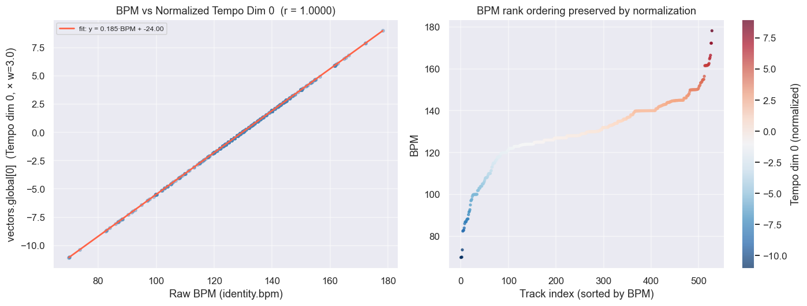{#fig-6-3}

*Figure 6.3 Normalised BPM reconstruction*

#### 6.1.3. Dimensionality reduction quality {#sec-6-1-3}

PCA is performed on the full 770-dimensional `vectors.global` (258 hand-crafted + 512 neural embedding dimensions) across all 529 tracks. The $$95\%$$ variance threshold is crossed at $$k = 29$$ components, well below the 50-component limit. $$\text{PC}_1$$ explains $$21.25\%$$ of total variance (dominant singular value $$S_0 = 128.39$$). The relatively large first-component share indicates a strong common structure across all tracks, capturing the overall spectral energy profile and neural embedding global directions. The scree plot (Figure 6.4) shows a classic elbow shape typical of music feature spaces, with no single dominant outlier dimension in this 529-track library:

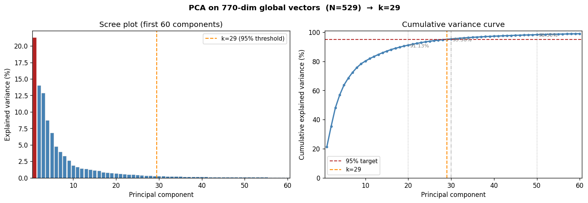{#fig-6-4}

*Figure 6.4 PCA scree plot and cumulative variance curve*

The relative Frobenius error (PCA reconstruction error) at $$k = 29$$ is [[27]](#ref-27):

$$E_{29} = \sqrt{1 - 0.9512} \approx 0.2209 \quad (22.1\%\ \text{information lost}) \tag{64}$$

This is mathematically equivalent to the 4.88% variance unexplained at $$k = 29$$ and is the expected trade-off for a $$95\%$$ retention target.

Moreover, a Python reconstruction of $$\text{PC}_1$$ from Python’s SVD was compared with the engine results (Figure 6.5), with cross-validation confirming a Pearson $$r = 0.9999$$ correlation and a maximum absolute error of $$< 1 \cdot 10^{-3}$$.

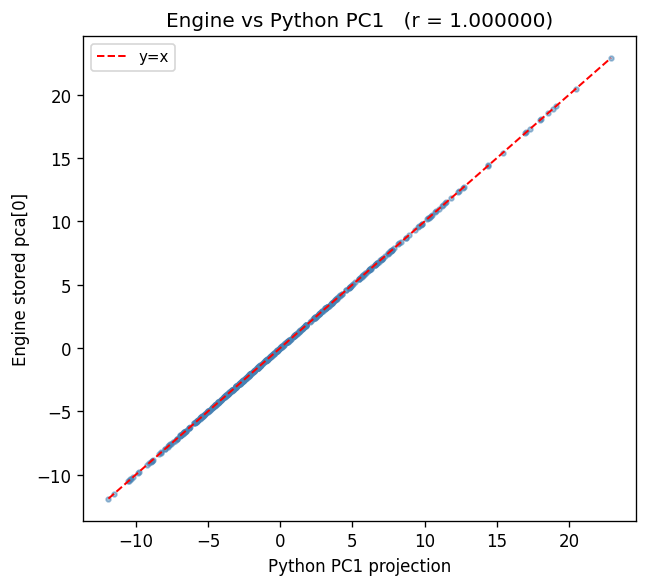{#fig-6-5}

*Figure 6.5 Comparison of SonoMap and Python PCA implementation*

UMAP projection is also computed on the full vector of all tracks, and its 2D layout spans:

*Table 6.2 UMAP range, centroid, and standard deviation*

| Axis | Range | Centroid | Std Dev |
|:-:|---|:-:|:-:|
| $$\boldsymbol{x}$$ | $$[-7.17, 6.67]$$ = 13.84 wide | $$\approx 0.00$$ | 3.55 |
| $$\boldsymbol{y}$$ | $$[-4.11, 5.85]$$ = 9.96 tall | $$\approx 0.00$$ | 2.17 |

The centroid at (0,0) and the approximately balanced ranges confirm that the embedding is well centred without excessive drift.

To prove the projection’s determinism, two independent Python SVD runs on the same centred matrix produce bitwise-identical singular values and component matrices ($$\max\Delta = 0.00$$ at floating-point precision). The C++ UMAP implementation uses `seed = 42` for both the random coordinate initialisation and the SGD optimisation, guaranteeing that identical library data produces bitwise-identical 2D coordinates.

UMAP implementation is successfully acoustically grounded in tempo, as evidenced by the Spearman correlation of $$r = +0.819$$ between BPM and UMAP $$x$$-axis. Additional comparison of the acoustic features in the layout can be found in Figure 6.6:

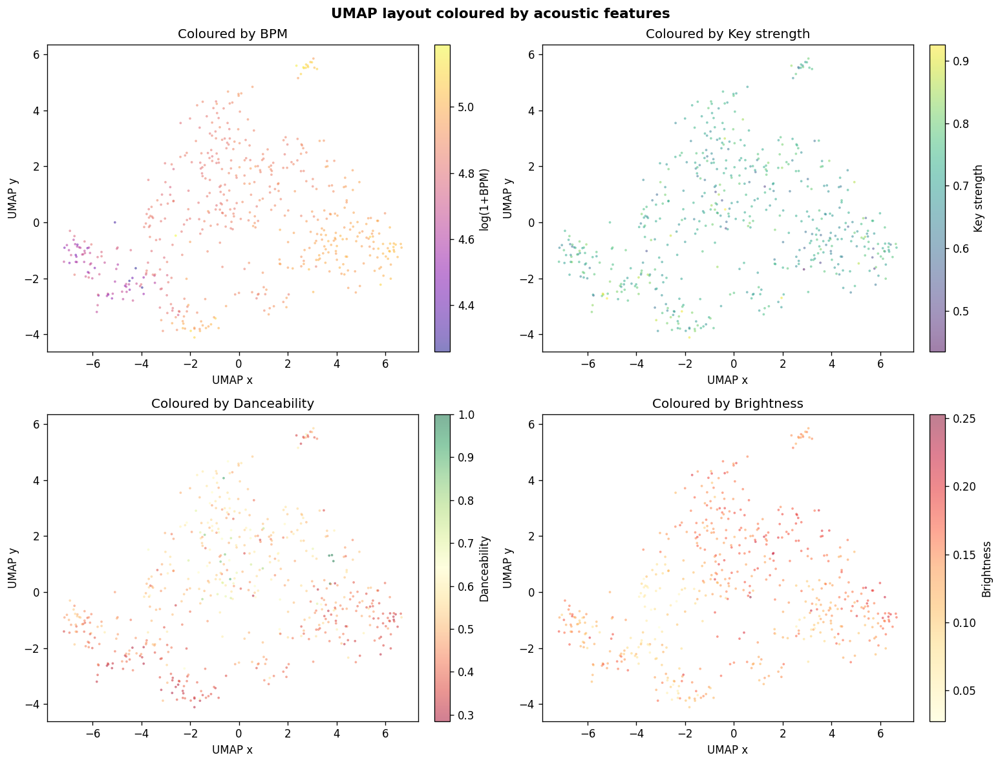{#fig-6-6}

*Figure 6.6 Correlation of UMAP coordinates and acoustic features*

Trustworthiness $$T$$ and Continuity $$C$$ measure how faithfully the 2D projection preserves the high-dimensional neighbourhood structure. [[42]](#ref-42) A value above $$0.85$$ for $$k = 15$$ indicates the layout faithfully preserves local neighbourhoods from PCA space:

$$T(k) = 1 - \frac{2}{nk(2n - 3k - 1)} \sum_{i=1}^{n} \sum_{j \in U_k(i)} \left(r(i,j) - k\right) \tag{65}$$

$$C(k) = 1 - \frac{2}{nk(2n - 3k - 1)} \sum_{i=1}^{n} \sum_{j \in V_k(i)} \left(\hat{r}(i,j) - k\right) \tag{66}$$

where $$r(i,j)$$ is the rank of $$j$$ in $$i$$’s high-dimensional neighbourhood, $$U_k(i)$$ are points in $$k$$-NN(UMAP) but not $$k$$-NN(PCA), while $$V_k(i)$$ is the reverse of $$U_k(i)$$.

Both metrics approach the $$\geq 0.85$$ target with $$T(k = 15) = 0.8498$$ and $$C(k = 15) = 0.8543$$. This means that when UMAP is evaluated against the full acoustic feature space, it faithfully preserves local neighbourhood structure. Approximately 85% of a track’s 15 nearest PCA neighbours are also among its 15 nearest UMAP neighbours, and vice versa.

#### 6.1.4. Clustering performance {#sec-6-1-4}

The clustering output produced 70 clusters, with none labelled as noise ($$-1$$). The silhouette score [[43]](#ref-43) of $$+0.061$$ in UMAP space is positive but low. A score near zero indicates that many tracks sit close to the boundary between clusters rather than being clearly embedded within a cluster’s core. This is consistent with 70 small clusters (mean size 7.6) packed into a relatively compact 2D space: per-point silhouette values straddle zero, with many tracks near neutral.

Intra-cluster BPM standard deviation provides a direct measure of tempo coherence within clusters. The global library BPM std is 16.21 BPM. The intra-cluster BPM std is substantially reduced relative to the global, confirming that the clustering procedure groups tracks of similar tempo together even when run in UMAP space. The key metric is the reduction ratio: clusters with BPM std $$\leq 5$$ BPM represent tightly tempo-coherent groups. The majority of clusters meet this criterion (Figure 6.7).

The between-cluster centroid standard deviation is close to the global BPM std, confirming that the 70 clusters are spread across the full tempo range of the library rather than all concentrating in the $$[128, 130]$$ BPM core.

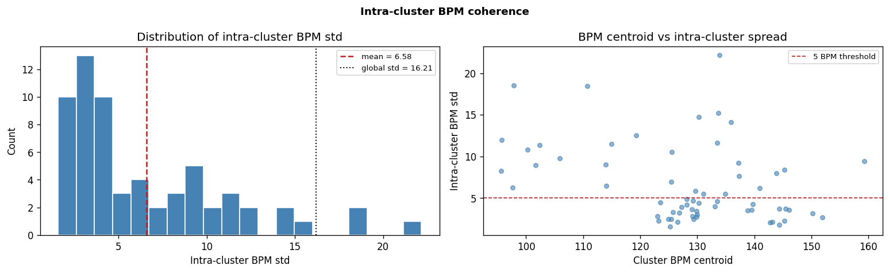{#fig-6-7}

*Figure 6.7 Intra-cluster BPM coherence*

For each cluster, the fraction of tracks sharing the most common Camelot key is computed. The random baseline for uniform key distribution is $$\frac{1}{24} \approx 4.2\%$$ (24 Camelot positions).

The observed mean key agreement substantially exceeds this random baseline (Figure 6.8), confirming that HDBSCAN clusters exhibit significant harmonic coherence despite being computed in UMAP space. A top-key agreement well above $$30\%$$–$$40\%$$ means that within a typical cluster, approximately one-third or more of tracks share the same Camelot position. The majority of clusters achieve $$\geq 50\%$$ key agreement, meaning that in most clusters the dominant key accounts for at least half the tracks.

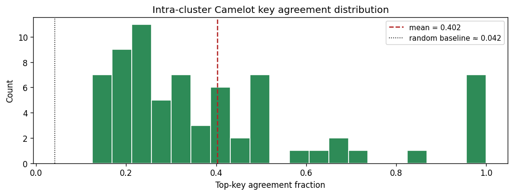{#fig-6-8}

*Figure 6.8 Intra-cluster Camelot key agreement*

#### 6.1.5. Recommendation algorithm performance {#sec-6-1-5}

Five anchor tracks spanning the UMAP $$x$$-axis quartiles (`seed = 42`) were audited for top-5 recommendations in both modes (Table 6.3), covering 124–142.5 BPM and four Camelot positions.

*Table 6.3 Selected anchor tracks overview*

| Anchor | BPM | Camelot | Key | Cluster |
|---|:-:|:-:|:-:|:-:|
| Anchor A | 124.0 | 12A | C# min | 40 |
| Anchor B | 127.0 | 12A | C# min | 9 |
| Anchor C | 132.0 | 8A | A min | 62 |
| Anchor D | 142.5 | 6B | A# maj | 70 |
| Anchor E | 140.9 | 5A | C min | 44 |

Aggregate non-strict quality (Table 6.4) shows 80% of all top-5 results within ±6% BPM and 48% an exact key match, confirming that the scoring modifiers actively shape the ranking; the low same-cluster rate (8%) is expected given 70 clusters, each with a mean size of 7.6.

*Table 6.4 Aggregate recommendation top-5 quality*

| Metric | Observed |
|---|---|
| **Top-1 BPM Δ mean** | 3.71% |
| **Top-1 BPM Δ max** | 6.43% |
| **Top-1 BPM within ±6%** | 4/5 anchors |
| **Top-1 Camelot Δ mean** | 0.60 steps |
| **Top-1 Camelot Δ ≤ 1** | 4/5 anchors |
| **BPM within ±6% (all 25 top-5)** | 20/25 (80%) |
| **Camelot Δ = 0 (all 25 top-5)** | 12/25 (48%) |
| **Same-cluster hits (all 25 top-5)** | 2/25 (8%) |

In strict mode, every anchor retained at least 27 compatible candidates (Table 6.5), anchor C's pool of 85 reflecting the density of the 8A (A minor) region. The top-1 result matched across modes for 3 of 5 anchors; in the other two, strict mode rejected the acoustically closest candidate for falling outside the BPM/key window and promoted the next compatible track, showing the filter is consequential rather than cosmetic.

*Table 6.5 Strict recommendation pool size*

| Anchor | BPM | Camelot | Pool size |
|---|:-:|:-:|:-:|
| **Anchor A** | 124.0 | 12A | 27 |
| **Anchor B** | 127.0 | 12A | 29 |
| **Anchor C** | 132.0 | 8A | 85 |
| **Anchor D** | 142.5 | 6B | 30 |
| **Anchor E** | 140.9 | 5A | 30 |

. Complete per-anchor results appear in Appendix B (non-strict) and Appendix C (strict).

### 6.2. Use cases {#sec-6-2}

SonoMap is used in a few characteristic ways. Pointed at a folder, it presents the whole collection as a 2D scatter plot with no configuration (Figure 6.9); acoustically similar tracks become spatial neighbours, so material from different folders sits together when it shares musical character, surfacing connections that folder organisation hides [[4]](#ref-4).

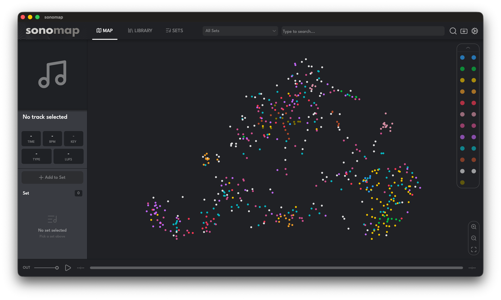{#fig-6-9}

*Figure 6.9 Initial state of the application user interface*

To plan a set, the DJ selects a starting track, and the toolbar lists the 15 highest-scoring candidates (Figure 6.10), each colour-coded by cluster, with connection lines tracing the planned trajectory and BPM/key multipliers promoted without manual filtering.

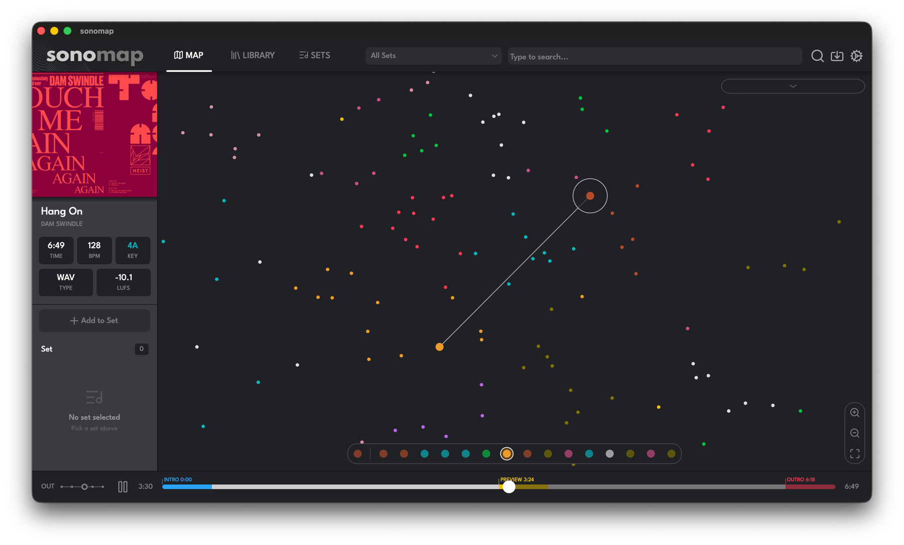{#fig-6-10}

*Figure 6.10 Track recommendation user interface*

Cluster chips and structured search queries (by title, artist, BPM, key, or source folder, e.g., `folder:"bandcamp" key:8A`) combine freely (Figure 6.11), allowing the DJ to restrict the canvas to a precise subset without altering any metadata. Because position reflects sound rather than tags, a forgotten track surfaces beside frequently played material of similar character, and zoom-to-selection frames it among its nearest neighbours.

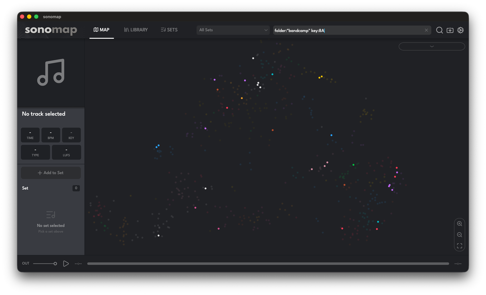{#fig-6-11}

*Figure 6.11 Scatter plot with active filtering state*

### 6.3. Future considerations {#sec-6-3}

Several areas of the audio analysis pipeline could be refined in future work. Key detection accuracy remains a known weak point in the current system and requires a dedicated improvement effort, whether through a more robust algorithm or a dedicated machine learning model. High-level descriptors such as danceability and the acoustic/electric ratio could likewise be enhanced to better reflect perceived musical qualities. A genre detection model would also further enrich the descriptor space to prevent currently observed outliers in clusters.

On the visualisation and usability side, a full beat-grid display is a natural extension, since the underlying beat-position data is already computed and available. Exporting playlists to industry-standard formats such as rekordbox or Serato would lower the barrier to practical adoption, allowing users to integrate generated sequences directly into their DJ workflows. The most advanced feature of transition previews would give immediate audible feedback on the quality of each suggested pairing by overlaying the end of one track with the beginning of the next.

Finally, the similarity and clustering layer offers room for further optimisation. Identifying and removing descriptors that contribute little to acoustic similarity would reduce noise in the embedding space and likely improve clustering quality. The current two-dimensional UMAP projection could be extended to three dimensions, or time could be introduced as an additional axis, enabling richer exploration of musical libraries.

## 7. Conclusion {#sec-7}

This thesis addressed a concrete limitation in music library management: organising by genre tags, artist names, and folder hierarchies describes music categorically rather than sonically, and breaks down at the scale a professional curator must handle. SonoMap demonstrates that acoustic similarity can be computed directly from the audio signal and turned into an intuitive, explorable two-dimensional map of an entire library.

Each stage of the pipeline contributed to this result. Feature extraction produced a 258-dimensional vector per track, spanning rhythmic, harmonic, spectral, timbral, and time-domain properties; a two-stage PCA-then-UMAP reduction collapsed this space into a 2D layout in which proximity reflects acoustic similarity, with a canonical orientation that grounds the axes in tempo and brightness. A three-tier neural enhancement, namely, a pretrained encoder, a library-adaptive MetricMLP, and an inductive GraphSAGE encoder, refined the feature geometry. The DJ-domain layer translated mixing theory into Camelot and BPM compatibility factors, combining them with embedding proximity into a single composite score.

Validation confirms the system meets its core goal. BPM detection aligned with industry-standard software and resolved the half- and double-time ambiguities that tripped up reference libraries; Mel-band energies and MFCCs closely matched librosa; and PCA and UMAP proved bitwise-deterministic while preserving local structure above the 80% trustworthiness and continuity threshold. The recommendation engine returned 80% BPM-compatible and 48% exact-key-matched top suggestions in non-strict mode. The key detector, by contrast, shows a measurable bias toward A and a compressed confidence scale, and the danceability and acoustic/electric descriptors are miscalibrated for electronic music, but these anomalies affect only interpretive labels, not the dimensions that drive distance, so the map remains valid for content-based exploration.

Conclusively, the system validates its central premise: a music library is more usefully organised by what its tracks sound like than by the metadata attached to them. The directions set out in the future considerations, including improved key detection and genre modelling, playlist export, transition previews, and higher-dimensional projections, mark the natural path from a working analytical prototype toward a tool ready for everyday professional curation.

---

Under full responsibility, I confirm in writing that this is my original work, no part therein created by copying or plagiarizing the content of a third party nor by generating using AI tools. In preparing the thesis, I used materials from third parties listed in the bibliography, but I did not copy any of their parts, except for quotations for which I cited the author and source and clearly marked them with quotation marks. In the event that the contrary is proven at any time, I am ready to bear all the consequences, including the annulment of the public document acquired in part and on the basis of this paper.

Zagreb, June 2026.

Student’s full name 
Jakov Kačan

---

## List of Abbreviations {#abbreviations}

| Abbreviation | Meaning |
|---|---|
| API | Application Programming Interface |
| BFCC | Bark Frequency Cepstral Coefficients |
| BLAS | Basic Linear Algebra Subprograms |
| BPM | Beats Per Minute |
| CENS | Chroma Energy Normalised Statistics |
| CPU | Central Processing Unit |
| DC | Direct Current |
| DBSCAN | Density-Based Spatial Clustering of Applications with Noise |
| DFA | Detrended Fluctuation Analysis |
| DJ | Disk Jockey |
| EOM | Excess-of-Mass |
| ERB | Equivalent Rectangular Bandwidth |
| FFT | Fast Fourier Transform |
| FFTW | Fast Fourier Transform in the West |
| GFCC | Gammatone Frequency Cepstral Coefficients |
| GraphSAGE | Graph SAmple and aggreGatE |
| HDBSCAN | Hierarchical Density-Based Spatial Clustering of Applications with Noise |
| HFC | High Frequency Content |
| HPCP | Harmonic Pitch Class Profile |
| HPSS | Harmonic/Percussive Source Separation |
| IBI | Inter-Beat Interval |
| I/O | Input/Output |
| IQR | Interquartile Range |
| JSON | JavaScript Object Notation |
| k-NN | k-Nearest Neighbours |
| Lo-Fi | Low Fidelity |
| LPC | Linear Predictive Coding |
| LUFS | Loudness Units Relative to Full Scale |
| MFCC | Mel-Frequency Cepstral Coefficients |
| MIDI | Musical Instrument Digital Interface |
| MIR | Music Information Retrieval |
| MLP | Multi-Layer Perceptron |
| MRD | Mutual-Reachability Distance |
| MST | Minimum Spanning Tree |
| MUSIG | Multi-task Sampling and Inductive Learning on Graphs |
| ONNX | Open Neural Network Exchange |
| PC | Principal Component |
| PCA | Principal Component Analysis |
| RMS | Root Mean Square |
| SFX | Sound Effects |
| SGD | Stochastic Gradient Descent |
| STE | Short-Time Energy |
| STFT | Short-Time Fourier Transform |
| SVD | Singular Value Decomposition |
| UI | User Interface |
| UMAP | Uniform Manifold Approximation and Projection |
| VST | Virtual Studio Technology |
| ZCR | Zero Crossing Rate |

## Table of Figures {#figures}

- [Figure 4.1 Camelot Wheel and the circle of fifths](#fig-4-1)
- [Figure 5.1 Pipeline architecture schematic](#fig-5-1)
- [Figure 6.1 Scatter plot visualisation](#fig-6-1)
- [Figure 6.2 Scatter plot visualisation with genre labels](#fig-6-2)
- [Figure 6.3 Normalised BPM reconstruction](#fig-6-3)
- [Figure 6.4 PCA scree plot and cumulative variance curve](#fig-6-4)
- [Figure 6.5 Comparison of SonoMap and Python PCA implementation](#fig-6-5)
- [Figure 6.6 Correlation of UMAP coordinates and acoustic features](#fig-6-6)
- [Figure 6.7 Intra-cluster BPM coherence](#fig-6-7)
- [Figure 6.8 Intra-cluster Camelot key agreement](#fig-6-8)
- [Figure 6.9 Initial state of the application user interface](#fig-6-9)
- [Figure 6.10 Track recommendation user interface](#fig-6-10)
- [Figure 6.11 Scatter plot with active filtering state](#fig-6-11)

## List of Tables {#tables}

- Table 2.1 List of spectral and timbral descriptors
- Table 2.2 Values and interpretation of spectral scalar descriptors
- Table 2.3 List of SFX descriptors
- Table 2.4 High-level derived classifiers and scalars
- Table 2.5 Audio features data structure overview
- Table 2.6 Pre-transformation application per feature group
- Table 2.7 Normalisation techniques applied per feature group
- Table 2.8 Feature group scalar multipliers
- Table 2.9 Structure of the global embedding vector
- Table 3.1 Centred matrix decomposition factors in PCA
- Table 3.2 UMAP hyperparameters
- Table 3.3 HDBSCAN hyperparameters
- Table 4.1 Penalty multipliers for Camelot distances
- Table 5.1 Data persistence files and types
- Table 6.1 L2 normalisation accuracy
- Table 6.2 UMAP range, centroid, and standard deviation
- Table 6.3 Selected anchor tracks overview
- Table 6.4 Aggregate recommendation top-5 quality
- Table 6.5 Strict recommendation pool size

## Bibliography {#bibliography}

1. D. Bogdanov, N. Wack, E. Gómez, S. Gulati, P. Herrera, O. Mayor, G. Roma, J. Salamon, J. Zapata and X. Serra, “Essentia: An Audio Analysis Library for Music Information Retrieval,” in *Proc. 14th Int. Society for Music Information Retrieval Conf. (ISMIR)*, Curitiba, Brazil, 2013.
2. A. Saravanou, F. Tomasi, R. Mehrotra and M. Lalmas, “Multi-Task Learning of Graph-based Inductive Representations of Music Content,” in *Proc. 22nd Int. Society for Music Information Retrieval Conf. (ISMIR)*, 2021.
3. W. L. Hamilton, R. Ying and J. Leskovec, “Inductive Representation Learning on Large Graphs,” in *Advances in Neural Information Processing Systems 30 (NeurIPS)*, 2017.
4. J. Shier, K. McNally, G. Tzanetakis and K. G. Brooks, “Manifold Learning Methods for Visualization and Browsing of Drum Machine Samples,” *Journal of the Audio Engineering Society*, vol. 69, no. 1/2, pp. 40-53, 2021.
5. L. van der Maaten and G. Hinton, “Visualizing Data using t-SNE,” *Journal of Machine Learning Research (JMLR)*, vol. 9, p. 2579–2605, 2008.
6. XLN Audio, “XO,” [Online]. Available: <https://www.xlnaudio.com/products/xo>. [Accessed 14 January 2026].
7. M. Müller, *Fundamentals of Music Processing: Audio, Analysis, Algorithms, Applications*, Cham, Switzerland: Springer, 2015.
8. O. Lartillot and P. Toiviainen, “MIR in MATLAB (II): A Toolbox for Musical Feature Extraction from Audio,” in *Proc. 8th Int. Conf. on Music Information Retrieval (ISMIR)*, Vienna, Austria, 2007.
9. E. Gómez, “Tonal Description of Music Audio Signals,” Universitat Pompeu Fabra, Barcelona, Spain, 2006.
10. M. Müller and S. Ewert, “Chroma Toolbox: MATLAB Implementations for Extracting Variants of Chroma-Based Audio Features,” in *Proc. 12th Int. Society for Music Information Retrieval Conf. (ISMIR)*, Miami, FL, USA, 2011.
11. C. Harte, M. Sandler and M. Gasser, “Detecting Harmonic Change in Musical Audio,” in *Proc. 1st ACM Workshop on Audio and Music Computing Multimedia (AMCMM)*, Santa Barbara, CA, USA, 2006.
12. W. A. Sethares, “Local Consonance and the Relationship Between Timbre and Scale,” *The Journal of the Acoustical Society of America*, vol. 94, no. 3, pp. 1218-1228, 1993.
13. M. Ciglar, “The Temporal Character of Timbre,” Institute of Electronic Music and Acoustics (IEM), University of Music and Performing Arts Graz, Graz, Austria, 2009.
14. S. B. Davis and P. Mermelstein, “Comparison of Parametric Representations for Monosyllabic Word Recognition in Continuously Spoken Sentences,” *IEEE Transactions on Acoustics, Speech, and Signal Processing*, vol. 28, no. 4, pp. 357-366, 1980.
15. G. Tzanetakis and P. Cook, “Musical Genre Classification of Audio Signals,” *IEEE Transactions on Speech and Audio Processing*, vol. 10, no. 5, pp. 293-302, 2002.
16. X. Valero and F. Alías, “Gammatone Cepstral Coefficients: Biologically Inspired Features for Non-Speech Audio Classification,” *IEEE Transactions on Multimedia*, vol. 14, no. 6, pp. 1684-1689, 2012.
17. E. Zwicker, “Subdivision of the Audible Frequency Range into Critical Bands (Frequenzgruppen),” *The Journal of the Acoustical Society of America*, vol. 33, no. 2, p. 248, 1961.
18. D.-N. Jiang, L. Lu, H.-J. Zhang, J.-H. Tao and L.-H. Cai, “Music Type Classification by Spectral Contrast Feature,” in *Proc. IEEE Int. Conf. on Multimedia and Expo (ICME)*, 2002.
19. H. Hermansky, “Perceptual Linear Predictive (PLP) Analysis of Speech,” *The Journal of the Acoustical Society of America*, vol. 87, no. 4, pp. 1738-1752, 1990.
20. D. FitzGerald, “Harmonic/Percussive Separation Using Median Filtering,” in *Proc. 13th Int. Conf. on Digital Audio Effects (DAFx-10)*, Graz, Austria, 2010.
21. T. Giannakopoulos and A. Pikrakis, *Introduction to Audio Analysis: A MATLAB Approach*, Oxford, UK: Academic Press, 2014.
22. International Telecommunication Union, “Recommendation ITU-R BS.1770-4: Algorithms to Measure Audio Programme Loudness and True-Peak Audio Level,” ITU, Geneva, Switzerland, 2015.
23. E. Vickers, “The Loudness War: Background, Speculation, and Recommendations,” in *Audio Engineering Society Convention 129*, San Francisco, CA, USA, 2010.
24. J. Han, M. Kamber and J. Pei, *Data Mining: Concepts and Techniques*, Waltham, MA, USA: Morgan Kaufmann, 2011.
25. G. Guennebaud and B. Jacob, “Eigen,” 2010. [Online]. Available: <http://eigen.tuxfamily.org>. [Accessed 16 May 2026].
26. R. E. Bellman, *Adaptive Control Processes: A Guided Tour*, Princeton, NJ, USA: Princeton University Press, 1961.
27. I. T. Jolliffe, *Principal Component Analysis*, New York, NY, USA: Springer, 2002.
28. L. McInnes, J. Healy and J. Melville, “UMAP: Uniform Manifold Approximation and Projection for Dimension Reduction,” 2018.
29. R. J. G. B. Campello, D. Moulavi, A. Zimek and J. Sander, “Hierarchical Density Estimates for Data Clustering, Visualization, and Outlier Detection,” *ACM Transactions on Knowledge Discovery from Data (TKDD)*, vol. 10, no. 1, p. Article 5, 2015.
30. M. Tan and Q. Le, “EfficientNet: Rethinking Model Scaling for Convolutional Neural Networks,” in *Proc. 36th Int. Conf. on Machine Learning (ICML)*, 2019.
31. P. Alonso-Jiménez, D. Bogdanov, J. Pons and X. Serra, “TensorFlow Audio Models in Essentia,” in *Proc. IEEE Int. Conf. on Acoustics, Speech and Signal Processing (ICASSP)*, Barcelona, Spain, 2020.
32. ONNX Community, “Open Neural Network Exchange (ONNX),” 2019. [Online]. Available: <https://onnx.ai>. [Accessed 21 May 2026].
33. F. Schroff, D. Kalenichenko and J. Philbin, “FaceNet: A Unified Embedding for Face Recognition and Clustering,” in *Proc. IEEE Conf. on Computer Vision and Pattern Recognition (CVPR)*, 2015.
34. D. P. Kingma and J. Ba, “Adam: A Method for Stochastic Optimization,” 2014.
35. I. Loshchilov and F. Hutter, “SGDR: Stochastic Gradient Descent with Warm Restarts,” 2016.
36. A. van den Oord, Y. Li and O. Vinyals, “Representation Learning with Contrastive Predictive Coding,” 2018.
37. G. Bernardes, M. E. P. Davies and C. Guedes, “A Hierarchical Harmonic Mixing Method,” in *Proc. 13th Int. Symposium on Computer Music Multidisciplinary Research (CMMR)*, Matosinhos, Portugal, 2017.
38. Mixed In Key, “Harmonic Mixing Guide,” [Online]. Available: <https://mixedinkey.com/harmonic-mixing-guide/>. [Accessed 26 May 2026].
39. T. Kim, M. Choi, E. Sacks, Y.-H. Yang and J. Nam, “A Computational Analysis of Real-World DJ Mixes using Mix-to-Track Subsequence Alignment,” in *Proc. 21st Int. Society for Music Information Retrieval Conf. (ISMIR)*, Montréal, Canada, 2020.
40. R. M. Bittner, M. Gu, G. Hernandez, E. J. Humphrey, T. Jehan, P. H. McCurry and N. Montecchio, “Automatic Playlist Sequencing and Transitions,” in *Proc. 17th Int. Society for Music Information Retrieval Conf. (ISMIR)*, New York, NY, USA, 2016.
41. B. McFee, C. Raffel, D. Liang, D. P. W. Ellis, M. McVicar, E. Battenberg and O. Nieto, “librosa: Audio and Music Signal Analysis in Python,” in *Proc. 14th Python in Science Conf. (SciPy)*, 2015.
42. J. Venna and S. Kaski, “Neighborhood Preservation in Nonlinear Projection Methods: An Experimental Study,” in *Artificial Neural Networks — ICANN 2001 (LNCS vol. 2130)*, 2001.
43. P. J. Rousseeuw, “Silhouettes: A Graphical Aid to the Interpretation and Validation of Cluster Analysis,” *Journal of Computational and Applied Mathematics*, vol. 20, pp. 53-65, 1987.

## Appendix A – SongRecord.h {#appendix-a}

| Field | Variable | Type | Source |
|---|---|---|---|
| **Metadata** | | | |
| Track ID | `track_id` | `string` | `AudioFileLoader` |
| Cluster ID | `cluster_id` | `int` | `HDBSCANClusterer` |
| Title | `title` | `string` | `TagLib` |
| Artist | `artist` | `string` | `TagLib` |
| File Path | `file_path` | `string` | `TagLib` |
| Cover Path | `cover_path` | `string` | `TagLib` |
| **Section Timestamps** | | | |
| Intro End (seconds) | `intro_end_sec` | `float` | `AudioAnalysisEngine` |
| Outro Start (seconds) | `outro_start_sec` | `float` | `AudioAnalysisEngine` |
| **Identity** | | | |
| BPM | `bpm` | `float` | `RhythmExtractor2013` |
| BPM Mean | `bpm_mean` | `float` | `AudioAnalysisEngine` |
| BPM Std Dev | `bpm_std` | `float` | `AudioAnalysisEngine` |
| BPM Centroid | `bpm_centroid` | `float` | `AudioAnalysisEngine` |
| Key | `key` | `MusicalKey` | `Key` |
| Scale | `scale` | `Scale` | `Key` |
| Key Strength | `key_strength` | `float` | `Key` |
| Camelot | `camelot` | `string` | `Key` |
| Tuning Offset (Hz) | `tuning_offset_hz` | `float` | `Key` |
| Time Signature Numerator | `time_signature_numerator` | `int` | `Meter` |
| Duration (seconds) | `duration_sec` | `float` | `AudioAnalysisEngine` |
| Perceptual Duration (seconds) | `perceptual_duration_sec` | `float` | `AudioAnalysisEngine` |
| Loudness RMS | `loudness_rms` | `float` | `RMS` |
| Loudness LUFS | `loudness_lufs` | `float` | `LoudnessEBUR128` |
| Loudness Leq | `loudness_leq` | `float` | `Leq` |
| Loudness Larm | `loudness_larm` | `float` | `Larm` |
| Loudness Vickers | `loudness_vickers` | `float` | `LoudnessVickers` |
| Replay Gain | `replay_gain` | `float` | `ReplayGain` |
| Dynamic Complexity | `dynamic_complexity` | `float` | `DynamicComplexity` |
| Danceability | `danceability` | `float` | `Danceability` |
| Chord Change Rate | `chord_change_rate` | `float` | `ChordsDescriptors` |
| Most Frequent Chord | `most_frequent_chord` | `string` | `ChordsDescriptors` |
| Fade In | `has_fade_in` | `bool` | `AudioAnalysisEngine` |
| Fade Out | `has_fade_out` | `bool` | `AudioAnalysisEngine` |
| Mood Flags | `mood_flags` | `uint8_t` | `AudioAnalysisEngine` |
| Genre | `genre` | `string` | `TagLib` |
| Acoustic/Electric Ratio | `acoustic_electric_ratio` | `float` | `AudioAnalysisEngine` |
| Perceptual Speed | `perceptual_speed` | `float` | `AudioAnalysisEngine` |
| Brightness | `brightness` | `float` | `AudioAnalysisEngine` |
| **Rhythm** | | | |
| Beat Positions (seconds) | `beat_positions_sec` | `vector<float>` | `RhythmExtractor2013` |
| Beat Loudness Mean | `beat_loudness_mean` | `float` | `BeatsLoudness` |
| Beat Loudness Std Dev | `beat_loudness_std` | `float` | `BeatsLoudness` |
| BPM Histogram Variance | `bpm_histogram_variance` | `float` | `AudioAnalysisEngine` |
| BPM Histogram Skewness | `bpm_histogram_skewness` | `float` | `AudioAnalysisEngine` |
| BPM Histogram Kurtosis | `bpm_histogram_kurtosis` | `float` | `AudioAnalysisEngine` |
| Onset Rate | `onset_rate` | `float` | `OnsetRate` |
| Onset HFC Mean | `onset_hfc_mean` | `float` | `OnsetDetection` |
| Onset Complex Mean | `onset_complex_mean` | `float` | `OnsetDetection` |
| Onset Flux mean | `onset_flux_mean` | `float` | `OnsetDetection` |
| Onset MelBand Flux Mean | `onset_melband_flux_mean` | `float` | `OnsetDetection` |
| Onset Energy Mean | `onset_energy_mean` | `float` | `OnsetDetection` |
| Rhythmic Complexity | `rhythmic_complexity` | `float` | `AudioAnalysisEngine` |
| Tempo Stability | `tempo_stability` | `float` | `AudioAnalysisEngine` |
| Rhythm Transform | `rhythm_transform` | `vector<float>` | `RhythmTransform` |
| BPM Rubato Start Times (seconds) | `bpm_rubato_start` | `vector<float>` | `BpmRubato` |
| BPM Rubato End Times (seconds) | `bpm_rubato_end` | `vector<float>` | `BpmRubato` |
| BPM Rubato Number | `bpm_rubato_number` | `int` | `BpmRubato` |
| **Harmonic** | | | |
| HPCP Mean | `hpcp_mean` | `array<float, 36>` | `HPCP` |
| HPCP Std Dev | `hpcp_std` | `array<float, 36>` | `HPCP` |
| Chroma STFT Mean | `chroma_stft_mean` | `array<float, 12>` | `HPCP` |
| Chroma STFT Std Dev | `chroma_stft_std` | `array<float, 12>` | `HPCP` |
| Chroma CENS Mean | `chroma_cens_mean` | `array<float, 12>` | `AudioAnalysisEngine` |
| Chroma CENS Std Dev | `chroma_cens_std` | `array<float, 12>` | `AudioAnalysisEngine` |
| Tonnetz Mean | `tonnetz_mean` | `array<float, 12>` | `AudioAnalysisEngine` |
| Tonnetz Std Dev | `tonnetz_std` | `array<float, 12>` | `AudioAnalysisEngine` |
| Chords Histogram | `chords_histogram` | `array<float, 24>` | `ChordsDescriptors` |
| Inharmonicity Mean | `inharmonicity_mean` | `float` | `Inharmonicity` |
| Inharmonicity Std Dev | `inharmonicity_std` | `float` | `Inharmonicity` |
| Dissonance Mean | `dissonance_mean` | `float` | `Dissonance` |
| Dissonance Std Dev | `dissonance_std` | `float` | `Dissonance` |
| Tristimulus | `tristimulus` | `array<float,3>` | `Tristimulus` |
| Odd To Even Harmonic Ratio | `odd_to_even_harmonic_ratio` | `float` | `OddToEvenHarmonicRatio` |
| Pitch Salience | `pitch_salience` | `float` | `PitchSalience` |
| Fundamental Frequency (Hz) | `fundamental_frequency` | `float` | `PitchYinFFT` |
| Pitch Histogram | `pitch_histogram` | `vector<float>` | `PitchYinFFT` |
| Equal Tempered Deviation | `equal_tempered_deviation` | `float` | `HighResolutionFeatures` |
| NonTempered Energy Ratio | `non_tempered_energy_ratio` | `float` | `HighResolutionFeatures` |
| NonTempered Peaks Energy Ratio | `non_tempered_peaks_energy_ratio` | `float` | `HighResolutionFeatures` |
| Vibrato Frequency (Hz) | `vibrato_frequency` | `float` | `Vibrato` |
| Vibrato Extent (cents) | `vibrato_extent` | `float` | `Vibrato` |
| **Spectral / Timbral** | | | |
| MFCC Mean | `mfcc_mean` | `vector<float>` | `MFCC` |
| MFCC Std Dev | `mfcc_std` | `vector<float>` | `MFCC` |
| GFCC Mean | `gfcc_mean` | `array<float, 13>` | `GFCC` |
| GFCC Std Dev | `gfcc_std` | `array<float, 13>` | `GFCC` |
| BFCC Mean | `bfcc_mean` | `array<float, 13>` | `BFCC` |
| BFCC Std Dev | `bfcc_std` | `array<float, 13>` | `BFCC` |
| Mel-Band Energies Mean | `mel_band_mean` | `vector<float>` | `MelBands` |
| Mel-Band Energies Std Dev | `mel_band_std` | `vector<float>` | `MelBands` |
| Bark-Band Energies Mean | `bark_band_mean` | `array<float, 24>` | `BarkBands` |
| Bark-Band Energies Std Dev | `bark_band_std` | `array<float, 24>` | `BarkBands` |
| ERB-Band Energies Mean | `erb_band_mean` | `array<float, 24>` | `ERBBands` |
| ERB-Band Energies Std Dev | `erb_band_std` | `array<float, 24>` | `ERBBands` |
| Spectral Contrast Peaks | `spectral_contrast_peaks` | `array<float, 7>` | `SpectralContrast` |
| Spectral Contrast Valleys | `spectral_contrast_valleys` | `array<float, 7>` | `SpectralContrast` |
| LPC Mean | `lpc_mean` | `float` | `LPC` |
| LPC Std Dev | `lpc_std` | `float` | `LPC` |
| Spectral Centroid Mean | `spectral_centroid_mean` | `float` | `Centroid` |
| Spectral Centroid Std Dev | `spectral_centroid_std` | `float` | `Centroid` |
| Spectral Bandwidth Mean | `spectral_bandwidth_mean` | `float` | `AudioAnalysisEngine` |
| Spectral Bandwidth Std Dev | `spectral_bandwidth_std` | `float` | `AudioAnalysisEngine` |
| Spectral Flatness Mean | `spectral_flatness_mean` | `float` | `Flatness` |
| Spectral Flatness Std Dev | `spectral_flatness_std` | `float` | `Flatness` |
| Spectral Rolloff Mean | `spectral_rolloff_mean` | `float` | `RollOff` |
| Spectral Rolloff Std Dev | `spectral_rolloff_std` | `float` | `RollOff` |
| Spectral Flux Mean | `spectral_flux_mean` | `float` | `Flux` |
| Spectral Flux Std Dev | `spectral_flux_std` | `float` | `Flux` |
| HFC Mean | `hfc_mean` | `float` | `HFC` |
| HFC Std Dev | `hfc_std` | `float` | `HFC` |
| Spectral Complexity | `spectral_complexity` | `float` | `SpectralComplexity` |
| Strong Peak | `strong_peak` | `float` | `StrongPeak` |
| **Time-Domain** | | | |
| ZCR Mean | `zcr_mean` | `float` | `AudioAnalysisEngine` |
| ZCR Std Dev | `zcr_std` | `float` | `AudioAnalysisEngine` |
| RMS Mean | `rms_mean` | `float` | `AudioAnalysisEngine` |
| RMS Std Dev | `rms_std` | `float` | `AudioAnalysisEngine` |
| RMS Max | `rms_max` | `float` | `AudioAnalysisEngine` |
| RMS 10th Percentile | `rms_p10` | `float` | `AudioAnalysisEngine` |
| RMS 90th Percentile | `rms_p90` | `float` | `AudioAnalysisEngine` |
| Short Time Energy Mean | `short_time_energy_mean` | `float` | `AudioAnalysisEngine` |
| Short Time Energy Std Dev | `short_time_energy_std` | `float` | `AudioAnalysisEngine` |
| Log Attack Time | `log_attack_time` | `float` | `LogAttackTime` |
| Envelope Centroid | `envelope_centroid` | `float` | `AudioAnalysisEngine` |
| Envelope Flatness | `envelope_flatness` | `float` | `AudioAnalysisEngine` |
| Harmonic Percussive Ratio | `harmonic_percussive_ratio` | `float` | `AudioAnalysisEngine` |
| Stereo Panorama Mean | `stereo_panorama_mean` | `float` | `AudioAnalysisEngine` |
| Stereo Panorama Std Dev | `stero_panorama_std` | `float` | `AudioAnalysisEngine` |
| Temporal Centroid To Total | `tc_to_total` | `float` | `TCToTotal` |
| Max Energy To Total | `max_to_total` | `float` | `MaxToTotal` |
| Min Energy To Total | `min_to_total` | `float` | `MinToTotal` |
| Mean Slope After Peak | `der_av_after_max` | `float` | `DerivativeSFX` |
| Max Slope Before Peak | `max_der_before_max` | `float` | `DerivativeSFX` |
| Envelope Shape Flatness | `flatness_sfx` | `float` | `FlatnessSFX` |
| **Embedding Vectors** | | | |
| Global | `global` | `vector<float>` | `LibraryScaler` |
| PCA | `pca` | `vector<float>` | `PCAReducer` |
| UMAP | `umap` | `vector<float>` | `UMAPProjector` |
| Intro | `intro` | `vector<float>` | `LibraryScaler` |
| Outro | `outro` | `vector<float>` | `LibraryScaler` |
| Neural | `neural` | `vector<float>` | `NeuralEncoder` |
| MetricMLP | `metric_mlp` | `vector<float>` | `MetricMLPTrainer` |
| GraphSAGE | `sage` | `vector<float>` | `GraphSAGETrainer` |

## Appendix B – Non-strict recommendation analysis {#appendix-b}

Anchor A

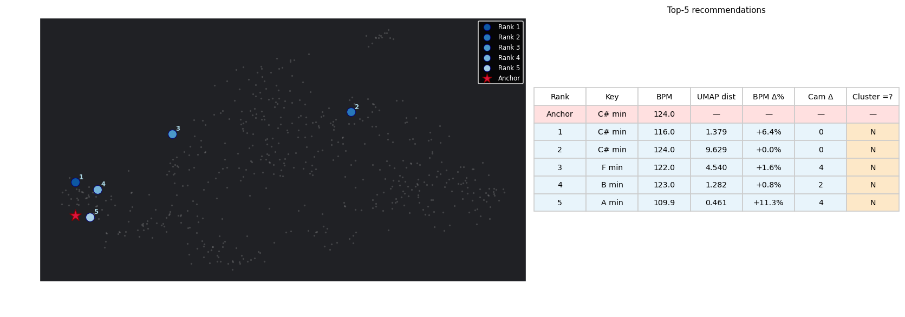

Anchor B

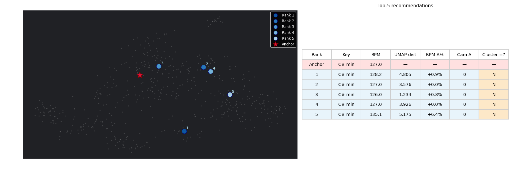

Anchor C

Anchor D

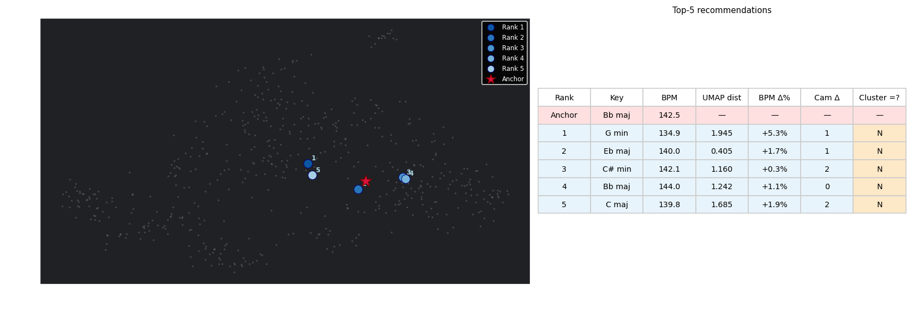

Anchor E

## Appendix C – Strict recommendation analysis {#appendix-c}

Anchor A

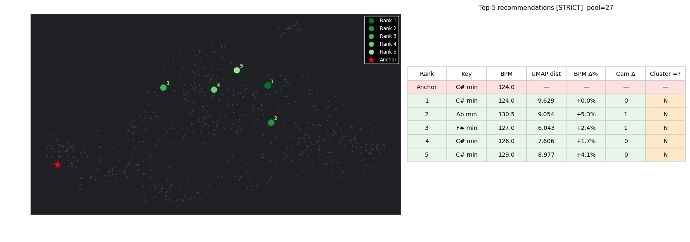

Anchor B

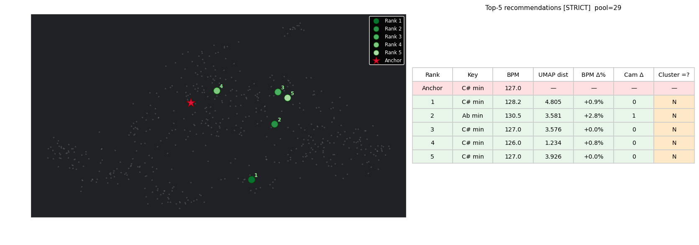

Anchor C

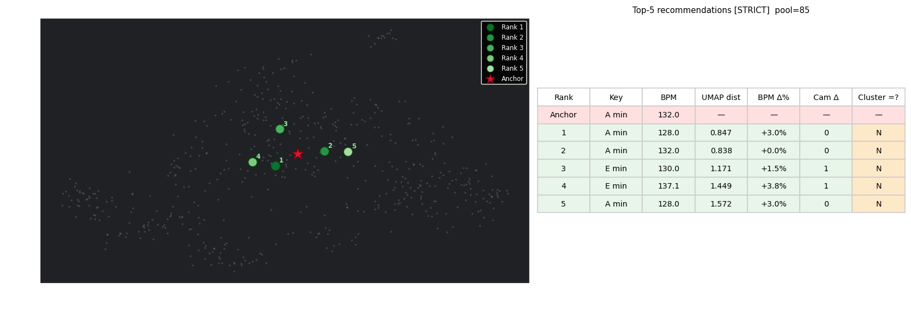

Anchor D

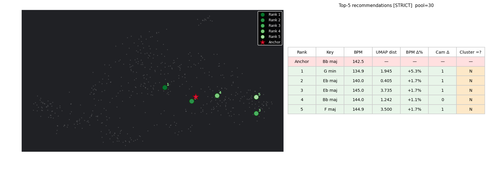

Anchor E

[^1]: Inter-beat interval
[^2]: Flatness and Spectral Contrast are conceptually related but capture different aspects: flatness is a global measure; contrast is sub-band localised.
[^3]: `toDb` yields values twice those of conventional power-dB for STE, but since all time-domain features are subsequently Z-score normalised, the factor has no effect on the final feature values.
[^4]: ONNX – Open Neural Network Exchange
[^5]: SonoMap supports creating user sets and calculating transition quality determined on intro and outro acoustic properties, but that feature is not in the scope of this thesis.
